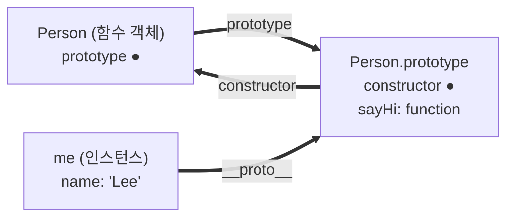

### 일급 객체

- 다음 조건을 만족하는 객체를 일급 객체라 한다.
  1. 무명의 리터럴로 생성할 수 있다. 즉 런타임에 생성이 가능하다.
  2. 변수나 자료구조(객체, 배열 등)에 저장할 수 있다.
  3. 함수의 매개변수에 전달할 수 있다.
  4. 함수의 반환값으로 사용할 수 있다.
- 자바스크립트의 함수는 위 조건을 모두 만족하므로 일급 객체다.
  - ```javascript
    // 1. 무명의 리터럴로 생성 / 2. 변수에 저장
    const increase = function (num) {
      return ++num;
    };

    // 2. 객체에 저장
    const auxs = { increase };

    // 3. 매개변수에 전달 / 4. 반환값으로 사용
    function makeCounter(aux) {
      let num = 0;
      return function () {
        num = aux(num);
        return num;
      };
    }
    ```
- 함수가 일급 객체라는 것은 함수를 **객체와 동일하게 사용할 수 있다**는 의미다.
  - 객체는 값이므로 함수도 값과 동일하게 취급할 수 있다.
- 함수는 값을 사용할 수 있는 곳이라면 어디서든 리터럴로 정의할 수 있고 런타임에 함수 객체로 평가된다.
- 일급 객체로서 함수가 갖는 가장 큰 특징은
  - 일반 객체와 같이 함수의 매개변수에 전달할 수 있고, 반환값으로도 사용할 수 있다는 것이다.
  - 이는 함수형 프로그래밍을 가능케 하는 자바스크립트의 장점 중 하나다.
- 함수는 객체이지만 일반 객체와 차이가 있다.
  - 일반 객체는 호출할 수 없지만 함수 객체는 호출할 수 있다.
  - 함수 객체는 일반 객체에는 없는 함수 고유의 프로퍼티를 소유한다.

### 함수 객체의 프로퍼티

- 함수도 객체이므로 프로퍼티를 가질 수 있다.
  - `console.dir(square)` 또는 `Object.getOwnPropertyDescriptors(square)`로 확인할 수 있다.
  - ```javascript
    function square(number) {
      return number * number;
    }

    Object.getOwnPropertyNames(square);
    // ['length', 'name', 'arguments', 'caller', 'prototype']
    ```
- arguments, caller, length, name, prototype 프로퍼티는 모두 함수 객체의 데이터 프로퍼티다.
  - 이들은 일반 객체에는 없는 함수 고유의 프로퍼티다.
- `__proto__`는 함수 객체 고유의 프로퍼티가 아니다.
  - Object.prototype 객체의 프로퍼티를 상속받은 것이다.

#### arguments 프로퍼티

- 함수 호출 시 전달된 인수들의 정보를 담고 있는 순회 가능한 유사 배열 객체다.
  - 함수 내부에서 지역 변수처럼 사용된다.
- 자바스크립트는 매개변수와 인수의 개수가 일치하는지 확인하지 않는다.
  - 인수가 부족하면 매개변수는 undefined로 초기화된다.
  - 초과된 인수는 무시되지만 arguments 객체에는 모두 보관된다.
  - ```javascript
    function multiply(x, y) {
      console.log(arguments);
      return x * y;
    }

    multiply(1, 2, 3); // [Arguments] { '0': 1, '1': 2, '2': 3 }
    ```
- 따라서 arguments 객체는 매개변수 개수를 확정할 수 없는 **가변 인자 함수**를 구현할 때 유용하다.
  - ```javascript
    function sum() {
      let res = 0;
      for (let i = 0; i < arguments.length; i++) res += arguments[i];
      return res;
    }

    sum(1, 2, 3); // 6
    ```
- arguments 객체는 유사 배열 객체이므로 배열 메서드를 사용할 수 없다.
  - 사용하려면 `Function.prototype.call`, `apply`로 간접 호출해야 하는 번거로움이 있다.
  - ES6의 Rest 파라미터를 사용하면 이러한 번거로움을 해결할 수 있다.
  - ```javascript
    function sum(...args) {
      return args.reduce((pre, cur) => pre + cur, 0); // 배열이므로 메서드 사용 가능
    }
    ```
- 화살표 함수에는 arguments 객체가 없다.

#### caller 프로퍼티

- 함수 자신을 호출한 함수를 가리킨다.
- ECMAScript 사양에 포함되지 않은 비표준 프로퍼티다.
  - 표준화될 예정도 없으므로 사용하지 않는다.

#### length 프로퍼티

- 함수를 정의할 때 선언한 **매개변수의 개수**를 가리킨다.
  - ```javascript
    function foo(x, y) {}
    foo.length; // 2
    ```
- arguments 객체의 length와 함수 객체의 length는 다르다.
  - arguments.length : 호출 시 전달된 **인수**의 개수
  - 함수의 length : 선언된 **매개변수**의 개수

#### name 프로퍼티

- 함수 이름을 나타낸다.
  - ES6에서 정식 표준이 되었다.
- 익명 함수 표현식의 경우 ES5와 ES6에서 다르게 동작한다.
  - ES5 : 빈 문자열을 값으로 갖는다.
  - ES6 : 함수 객체를 가리키는 식별자를 값으로 갖는다.
  - ```javascript
    var namedFunc = function foo() {};
    namedFunc.name; // 'foo'

    var anonymousFunc = function () {};
    anonymousFunc.name; // ES5: '' / ES6: 'anonymousFunc'
    ```
- 함수 이름과 함수 객체를 가리키는 식별자는 의미가 다르다는 점에 주의해야 한다.
  - 함수를 호출할 때는 함수 이름이 아닌 식별자로 호출한다.

#### \_\_proto\_\_ 접근자 프로퍼티

- 모든 객체는 `[[Prototype]]`이라는 내부 슬롯을 갖는다.
  - 이는 객체지향 프로그래밍의 상속을 구현하는 프로토타입 객체를 가리킨다.
- `__proto__`는 `[[Prototype]]` 내부 슬롯이 가리키는 프로토타입 객체에 접근하기 위한 접근자 프로퍼티다.
  - 내부 슬롯에는 직접 접근할 수 없고 간접적인 접근 방법을 제공하는 경우에만 접근할 수 있다.
  - ```javascript
    const obj = { a: 1 };

    obj.__proto__ === Object.prototype; // true
    obj.hasOwnProperty("a"); // true (Object.prototype에서 상속)
    ```
- hasOwnProperty 메서드는 인수로 전달받은 프로퍼티 키가 객체 고유의 프로퍼티 키인 경우에만 true를 반환한다.
  - 상속받은 프로토타입의 프로퍼티 키인 경우 false를 반환한다.
  - 상속받은 프로퍼티까지 확인하려면 in 연산자를 사용한다.
  - ```javascript
    function Person(name) {
      this.name = name;
    }
    Person.prototype.sayHi = function () {
      return "Hi " + this.name;
    };

    const me = new Person("Lee");

    me.hasOwnProperty("name"); // true (고유 프로퍼티)
    me.hasOwnProperty("sayHi"); // false (상속받은 프로퍼티)
    "sayHi" in me; // true (in은 상속까지 확인한다)
    ```
- `__proto__`도 고유 프로퍼티가 아니라 Object.prototype에서 상속받은 것이다.
  - ```javascript
    const obj = { a: 1 };

    obj.hasOwnProperty("__proto__"); // false
    Object.prototype.hasOwnProperty("__proto__"); // true
    ```
- 직접 사용하는 것은 권장되지 않으며 Object.getPrototypeOf를 사용한다.
  - `__proto__`는 ES5까지 비표준이었고 하위 호환성을 위해 표준이 되었다.

#### prototype 프로퍼티

- 생성자 함수로 호출할 수 있는 함수 객체, 즉 **constructor만이 소유하는 프로퍼티**다.
  - 일반 객체와 생성자 함수로 호출할 수 없는 non-constructor에는 prototype 프로퍼티가 없다.
  - ```javascript
    (function () {}).hasOwnProperty("prototype"); // true
    ({}).hasOwnProperty("prototype"); // false
    ```
- 함수가 객체를 생성하는 생성자 함수로 호출될 때
  - 생성자 함수가 생성할 인스턴스의 프로토타입 객체를 가리킨다.
- 화살표 함수와 메서드 축약 표현으로 정의한 메서드는 non-constructor이므로 prototype 프로퍼티가 없다.
  - new로 호출할 수 없으므로 인스턴스의 부모가 될 객체가 필요 없기 때문이다.
  - ```javascript
    const Arrow = () => {};

    Arrow.prototype; // undefined
    new Arrow(); // TypeError: Arrow is not a constructor
    ```
- `prototype`과 `__proto__`는 **같은 객체를 양쪽에서 부르는 이름**이다.
  - 생성자 함수 입장에서는 `prototype`, 인스턴스 입장에서는 `__proto__`다.
  - ```javascript
    function Person(name) {
      this.name = name;
    }
    const me = new Person("Lee");

    Person.prototype === me.__proto__; // true (같은 객체)

    Person.hasOwnProperty("prototype"); // true (함수만 소유)
    me.hasOwnProperty("prototype"); // false (인스턴스는 갖지 않는다)
    ```

|            | 소유자                      | 의미                            |
| ---------- | --------------------------- | ------------------------------- |
| `prototype` | 생성자로 호출 가능한 함수   | 내가 생성할 인스턴스의 프로토타입 |
| `__proto__` | 모든 객체 (상속받은 접근자) | 자신의 프로토타입               |



- 즉 인스턴스는 `prototype` 프로퍼티를 갖지 않고 프로토타입 객체를 참조만 한다.
  - 따라서 자신에게 없는 프로퍼티는 프로토타입 체인을 따라 찾아 사용한다.
- 프로토타입 객체는 constructor 프로퍼티로 자신을 생성한 생성자 함수를 가리킨다.
  - ```javascript
    Person.prototype.constructor === Person; // true
    me.constructor === Person; // true (상속받아 참조한다)
    ```
