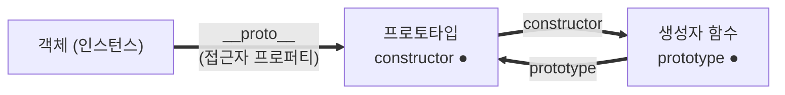
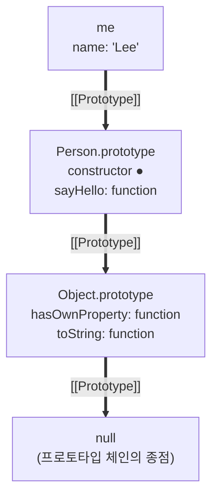

### 객체지향 프로그래밍

- 객체지향 프로그래밍은 프로그램을 독립적 단위인 **객체의 집합**으로 표현하려는 프로그래밍 패러다임이다.
  - 실세계의 실체를 인식하는 철학적 사고를 프로그래밍에 접목하려는 시도에서 시작한다.
- 실체는 특징이나 성질을 나타내는 **속성(attribute/property)** 을 가지고 있다.
  - 이를 통해 실체를 인식하거나 구별할 수 있다.
- 다양한 속성 중에서 프로그램에 필요한 속성만 간추려 표현하는 것을 **추상화(abstraction)** 라 한다.
  - ```javascript
    // 이름과 주소라는 속성만 간추렸다
    const person = {
      name: "Lee",
      address: "Seoul",
    };
    ```
- 객체란 속성을 통해 여러 개의 값을 하나의 단위로 구성한 복합적인 자료구조다.
  - 이때 객체의 상태 데이터를 **프로퍼티**, 동작을 **메서드**라 부른다.
  - 즉 객체는 상태와 동작을 하나의 논리적인 단위로 묶은 복합적인 자료구조다.
  - ```javascript
    const circle = {
      radius: 5, // 상태

      getDiameter() {
        // 동작
        return 2 * this.radius;
      },
    };
    ```
- 각 객체는 고유의 기능을 수행하면서 다른 객체와 관계성을 가질 수 있다.
  - 다른 객체와 메시지를 주고받거나 데이터를 처리할 수도 있고, 다른 객체의 상태나 동작을 상속받아 사용하기도 한다.

### 상속과 프로토타입

- 상속은 어떤 객체의 프로퍼티 또는 메서드를 다른 객체가 상속받아 그대로 사용할 수 있는 것을 말한다.
  - 자바스크립트는 **프로토타입을 기반으로 상속을 구현**하여 불필요한 중복을 제거한다.
- 생성자 함수가 생성할 모든 인스턴스가 동일한 메서드를 중복 소유하는 것은 메모리를 낭비한다.
  - ```javascript
    function Circle(radius) {
      this.radius = radius;
      // 인스턴스마다 getArea 메서드를 중복 생성한다
      this.getArea = function () {
        return Math.PI * this.radius ** 2;
      };
    }

    const circle1 = new Circle(1);
    const circle2 = new Circle(2);

    console.log(circle1.getArea === circle2.getArea); // false (별개의 함수 객체다)
    ```
  - 즉 인스턴스를 100개 생성하면 동일한 내용의 함수 객체가 100개 생성된다.
- 상속을 통해 **불필요한 중복을 제거**할 수 있다.
  - 자바스크립트는 프로토타입을 기반으로 상속을 구현한다.
  - ```javascript
    function Circle(radius) {
      this.radius = radius;
    }

    // 프로토타입에 추가하면 모든 인스턴스가 상속받아 공유한다
    Circle.prototype.getArea = function () {
      return Math.PI * this.radius ** 2;
    };

    const circle1 = new Circle(1);
    const circle2 = new Circle(2);

    console.log(circle1.getArea === circle2.getArea); // true (하나의 함수를 공유한다)
    ```
- 메모리 관점에서 보면 **함수 객체가 복제되는 것이 아니라 주소만 공유된다**. ([17장](./17.생성자함수에_의한_객체생성.md#생성자-함수의-인스턴스-생성-과정))
  - 인스턴스가 생성될 때 `[[Prototype]]` 내부 슬롯에 프로토타입의 주소가 저장된다.
  - ```
    힙(Heap)
    ┌─────────────────────────────────┐
    │ 0x100: {                        │  circle1
    │   radius: 1                     │
    │   [[Prototype]] → 0x300         │ ──┐
    │ }                               │   │
    │                                 │   │
    │ 0x200: {                        │  circle2
    │   radius: 2                     │   │
    │   [[Prototype]] → 0x300         │ ──┤
    │ }                               │   │
    │                                 │   │
    │ 0x300: {                        │ ←─┘  Circle.prototype
    │   constructor → Circle          │
    │   getArea: function             │  함수 객체는 여기 하나뿐이다
    │ }                               │
    └─────────────────────────────────┘
    ```
  - 따라서 인스턴스를 100개 생성해도 getArea 함수 객체는 **하나**이고 주소만 100번 공유된다.
    - 반면 생성자 함수 내부에 메서드를 정의하면 인스턴스마다 함수 객체가 새로 생성된다.
  - 인스턴스마다 달라지는 radius는 각자의 객체에 저장되므로 공유해도 값이 섞이지 않는다.
- 즉 radius처럼 **인스턴스마다 달라야 하는 상태는 고유 프로퍼티로**,
  - getArea처럼 **내용이 동일한 동작은 프로토타입에** 두는 것이 바람직하다.

### 프로토타입 객체

- 프로토타입 객체는 객체지향 프로그래밍의 근간을 이루는 객체 간 상속을 구현하기 위해 사용된다.
  - 프로토타입은 어떤 객체의 상위(부모) 객체의 역할을 하는 객체로서 다른 객체에 공유 프로퍼티를 제공한다.
- 모든 객체는 `[[Prototype]]`이라는 내부 슬롯을 가지며 이 내부 슬롯의 값은 프로토타입의 참조다.
  - 값이 null인 경우도 있으며, 이때는 프로토타입이 없다는 의미다.
  - `[[Prototype]]`에 저장되는 프로토타입은 **객체 생성 방식에 의해 결정**된다.
- `[[Prototype]]` 내부 슬롯에는 직접 접근할 수 없지만
  - `__proto__` 접근자 프로퍼티를 통해 간접적으로 접근할 수 있다.
- 프로토타입은 자신의 constructor 프로퍼티를 통해 생성자 함수에 접근할 수 있고
  - 생성자 함수는 자신의 prototype 프로퍼티를 통해 프로토타입에 접근할 수 있다.



#### `__proto__` 접근자 프로퍼티

- **객체는 `__proto__` 접근자 프로퍼티를 통해 자신의 프로토타입에 간접적으로 접근할 수 있다**.
  - 단 `__proto__`는 객체 고유의 프로퍼티가 아니라 Object.prototype에서 상속받는 것이므로
  - **Object.prototype을 상속받지 않는 객체는 사용할 수 없다**.
  - ```javascript
    const obj = {};
    const parent = { x: 1 };

    obj.__proto__; // getter 함수인 get __proto__가 호출된다
    obj.__proto__ = parent; // setter 함수인 set __proto__가 호출된다

    console.log(obj.x); // 1 (parent를 상속받았다)
    ```

##### `__proto__`는 접근자 프로퍼티다

- `__proto__`는 자체적으로 값을 갖지 않고 `[[Get]]`, `[[Set]]` 접근자 함수로 구성된 접근자 프로퍼티다. ([16장](../../week06/윤홍비/16.프로퍼티_어트리뷰트.md#접근자-프로퍼티))
  - 즉 프로토타입을 취득하거나 교체할 때 호출된다.

##### `__proto__`는 상속을 통해 사용된다

- `__proto__` 접근자 프로퍼티는 객체가 직접 소유하는 프로퍼티가 아니라
  - **Object.prototype의 프로퍼티**이며 이를 상속받은 객체가 사용할 수 있다.
  - ```javascript
    const person = { name: "Lee" };

    person.hasOwnProperty("__proto__"); // false (고유 프로퍼티가 아니다)
    Object.getOwnPropertyDescriptor(Object.prototype, "__proto__");
    // { get: f, set: f, enumerable: false, configurable: true }

    person.__proto__ === Object.prototype; // true
    ```

##### `__proto__` 접근자 프로퍼티를 통해 프로토타입에 접근하는 이유

- **상호 참조에 의해 프로토타입 체인이 생성되는 것을 방지**하기 위해서다.
  - ```javascript
    const parent = {};
    const child = {};

    child.__proto__ = parent;
    parent.__proto__ = child; // TypeError: Cyclic __proto__ value
    ```
- 프로토타입 체인은 **단방향 링크드 리스트로 구현되어야** 한다.
  - 순환 참조하는 체인이 만들어지면 프로퍼티를 검색할 때 무한 루프에 빠진다.
  - 따라서 아무런 검사 없이 무조건 교체할 수 없도록 접근자 프로퍼티를 통해서만 접근하게 한 것이다.

##### `__proto__` 접근자 프로퍼티를 코드 내에서 직접 사용하는 것은 권장되지 않는다

- 모든 객체가 `__proto__`를 사용할 수 있는 것은 아니기 때문이다.
  - 직접 상속을 통해 Object.prototype을 상속받지 않는 객체를 생성할 수도 있다.
  - ```javascript
    // 프로토타입 체인의 종점이므로 __proto__를 상속받을 수 없다
    const obj = Object.create(null);

    console.log(obj.__proto__); // undefined
    console.log(Object.getPrototypeOf(obj)); // null
    ```
- 따라서 프로토타입의 참조를 취득하려면 **Object.getPrototypeOf**를,
  - 프로토타입을 교체하려면 **Object.setPrototypeOf**를 사용할 것을 권장한다.

| 목적        | 권장 방법                | 비권장 (`__proto__`)    |
| ----------- | ------------------------ | ----------------------- |
| 취득        | `Object.getPrototypeOf`  | `obj.__proto__`         |
| 교체        | `Object.setPrototypeOf`  | `obj.__proto__ = parent` |

#### 함수 객체의 prototype 프로퍼티

- **prototype 프로퍼티는 생성자 함수가 생성할 인스턴스의 프로토타입을 가리킨다**.
  - 함수만 가질 수 있고 일반 객체는 갖지 않는다.
  - ```javascript
    (function () {}).hasOwnProperty("prototype"); // true
    ({}).hasOwnProperty("prototype"); // false
    ```
- 단 함수라고 해서 모두 갖는 것은 아니다.
  - **new를 붙여 호출할 수 있는 함수만** prototype 프로퍼티를 갖는다. ([17장](./17.생성자함수에_의한_객체생성.md#constructor와-non-constructor의-구분))
  - ```javascript
    const Arrow = () => {};
    const obj = { foo() {} };

    Arrow.hasOwnProperty("prototype"); // false
    obj.foo.hasOwnProperty("prototype"); // false
    ```
- 객체가 상속받아 사용하는 `__proto__` 접근자 프로퍼티와 함수가 가지고 있는 prototype 프로퍼티는
  - **결국 동일한 프로토타입을 가리킨다**.
  - 하지만 프로퍼티를 사용하는 주체가 다르다.

| 구분                     | 소유             | 값                | 사용 주체   | 사용 목적                                       |
| ------------------------ | ---------------- | ----------------- | ----------- | ----------------------------------------------- |
| `__proto__` 접근자 프로퍼티 | Object.prototype | 프로토타입의 참조 | 상속받은 객체 | 객체가 자신의 프로토타입에 접근 또는 교체       |
| `prototype` 프로퍼티     | 함수             | 프로토타입의 참조 | 생성자 함수 | 생성자 함수가 자신이 생성할 객체의 프로토타입 할당 |

- ```javascript
  function Person(name) {
    this.name = name;
  }

  const me = new Person("Lee");

  Person.prototype === me.__proto__; // true (동일한 프로토타입이다)
  ```

#### 프로토타입의 constructor 프로퍼티와 생성자 함수

- 모든 프로토타입은 constructor 프로퍼티를 갖는다.
  - 이 constructor 프로퍼티는 **prototype 프로퍼티로 자신을 참조하고 있는 생성자 함수를 가리킨다**.
  - 이 연결은 함수 객체가 생성될 때 이뤄진다.
  - ```javascript
    function Person(name) {
      this.name = name;
    }

    const me = new Person("Lee");

    me.constructor === Person; // true (프로토타입에서 상속받아 참조한다)
    Person.prototype.constructor === Person; // true
    ```
- me 객체에는 constructor 프로퍼티가 없지만 프로토타입인 Person.prototype에는 있다.
  - 따라서 me 객체는 프로토타입의 constructor 프로퍼티를 상속받아 사용할 수 있다.

### 리터럴 표기법에 의해 생성된 객체의 생성자 함수와 프로토타입

- 리터럴 표기법에 의한 객체 생성 방식처럼 명시적으로 new 연산자와 함께 생성자 함수를 호출하지 않는 방식도 있다.
  - ```javascript
    const obj = {};
    const add = function (a, b) {
      return a + b;
    };
    const arr = [1, 2, 3];
    const regexp = /is/gi;
    ```
  - 이 객체들도 프로토타입이 존재하지만 **constructor 프로퍼티가 가리키는 생성자 함수가 반드시 객체를 생성한 생성자 함수라고 단정할 수 없다**.
  - ```javascript
    const obj = {};

    obj.constructor === Object; // true (하지만 Object 생성자 함수가 생성한 것은 아니다)
    ```
- 즉 리터럴로 생성한 객체도 상속을 위해 프로토타입이 필요하므로
  - **가상적인 생성자 함수를 갖게 된다**.
  - 프로토타입은 생성자 함수와 더불어 생성되며 prototype, constructor 프로퍼티에 의해 연결되어 있기 때문이다.
  - 다시 말해 **프로토타입과 생성자 함수는 단독으로 존재할 수 없고 언제나 쌍으로 존재한다**.
- 따라서 리터럴 표기법으로 생성한 객체도 **상속을 위해 프로토타입이 필요**하므로
  - 가상적인 생성자 함수를 가지며 프로토타입도 생성된다.

| 리터럴 표기법      | 생성자 함수 | 프로토타입           |
| ------------------ | ----------- | -------------------- |
| 객체 리터럴        | Object      | `Object.prototype`   |
| 함수 리터럴        | Function    | `Function.prototype` |
| 배열 리터럴        | Array       | `Array.prototype`    |
| 정규 표현식 리터럴 | RegExp      | `RegExp.prototype`   |

### 프로토타입의 생성 시점

- 프로토타입은 **생성자 함수가 생성되는 시점에 더불어 생성된다**.
  - 프로토타입과 생성자 함수는 언제나 쌍으로 존재하기 때문이다.
- 생성자 함수는 사용자가 직접 정의한 사용자 정의 생성자 함수와 빌트인 생성자 함수로 구분할 수 있다.

#### 사용자 정의 생성자 함수와 프로토타입 생성 시점

- 생성자 함수로서 호출할 수 있는 함수, 즉 constructor는
  - **함수 정의가 평가되어 함수 객체를 생성하는 시점에 프로토타입도 더불어 생성된다**.
  - ```javascript
    // 함수 선언문은 런타임 이전에 평가되므로 이미 프로토타입이 생성되어 있다
    console.log(Person.prototype); // {constructor: f}

    function Person(name) {
      this.name = name;
    }
    ```
- 반면 non-constructor는 프로토타입이 생성되지 않는다.
  - ```javascript
    const Arrow = () => {};

    console.log(Arrow.prototype); // undefined
    ```
- 생성된 프로토타입은 오직 constructor 프로퍼티만을 갖는 객체다.
  - 프로토타입도 객체이므로 자신의 프로토타입을 가지며 이는 Object.prototype이다.

#### 빌트인 생성자 함수와 프로토타입 생성 시점

- Object, String, Number, Function, Array, RegExp, Date, Promise 등의 빌트인 생성자 함수는
  - **전역 객체가 생성되는 시점에 생성된다**.
  - 이때 생성된 프로토타입은 빌트인 생성자 함수의 prototype 프로퍼티에 바인딩된다.
- 전역 객체는 코드가 실행되기 이전 자바스크립트 엔진에 의해 생성되는 특수한 객체다.
  - 브라우저에서는 window, Node.js에서는 global이 전역 객체를 가리킨다.
- 이처럼 **객체가 생성되기 이전에 생성자 함수와 프로토타입은 이미 객체화되어 존재한다**.
  - 이후 객체를 생성하면 프로토타입은 생성된 객체의 `[[Prototype]]` 내부 슬롯에 할당된다.
  - 이로써 생성된 객체는 프로토타입을 상속받는다.

### 객체 생성 방식과 프로토타입의 결정

- 객체는 다양한 생성 방법이 있지만 세부적인 객체 생성 방식의 차이는 있으나
  - 추상 연산 **OrdinaryObjectCreate**에 의해 생성된다는 공통점이 있다.
- OrdinaryObjectCreate는 자신이 생성할 객체의 프로토타입을 인수로 전달받는다.
  - 즉 **프로토타입은 추상 연산에 전달되는 인수에 의해 결정되고, 이 인수는 객체가 생성되는 시점에 객체 생성 방식에 의해 결정된다**.

#### 객체 리터럴에 의해 생성된 객체의 프로토타입

- 객체 리터럴을 평가하면 OrdinaryObjectCreate를 호출하면서 Object.prototype을 전달한다.
  - 즉 객체 리터럴에 의해 생성되는 객체의 프로토타입은 **Object.prototype**이다.
  - ```javascript
    const obj = { x: 1 };

    obj.hasOwnProperty("x"); // true (Object.prototype의 메서드를 상속받았다)
    Object.getPrototypeOf(obj) === Object.prototype; // true
    ```

#### Object 생성자 함수에 의해 생성된 객체의 프로토타입

- Object 생성자 함수를 호출하면 OrdinaryObjectCreate가 호출되고 Object.prototype이 전달된다.
  - 즉 객체 리터럴과 동일하게 프로토타입은 **Object.prototype**이다.
  - ```javascript
    const obj = new Object();
    obj.x = 1;

    Object.getPrototypeOf(obj) === Object.prototype; // true
    ```
- 객체 리터럴과 Object 생성자 함수는 프로토타입이 동일하지만 프로퍼티를 추가하는 방식이 다르다.
  - 객체 리터럴은 리터럴 내부에 프로퍼티를 추가하지만
  - Object 생성자 함수는 빈 객체를 생성한 이후 프로퍼티를 추가해야 한다.

#### 생성자 함수에 의해 생성된 객체의 프로토타입

- new 연산자와 함께 생성자 함수를 호출하면 OrdinaryObjectCreate가 호출되고
  - **생성자 함수의 prototype 프로퍼티에 바인딩되어 있는 객체**가 전달된다.
  - ```javascript
    function Person(name) {
      this.name = name;
    }

    const me = new Person("Lee");

    Object.getPrototypeOf(me) === Person.prototype; // true
    ```
- 표준 빌트인 객체인 Object의 프로토타입은 다양한 빌트인 메서드를 갖지만
  - 사용자 정의 생성자 함수의 프로토타입은 constructor 프로퍼티만 갖는 객체다.
- 프로토타입도 객체이므로 **프로퍼티를 추가하거나 삭제할 수 있다**.
  - 이렇게 추가하거나 삭제한 프로퍼티는 프로토타입 체인에 즉각 반영된다.
  - ```javascript
    function Person(name) {
      this.name = name;
    }

    Person.prototype.sayHello = function () {
      console.log(`Hi! My name is ${this.name}`);
    };

    const me = new Person("Lee");
    const you = new Person("Kim");

    me.sayHello(); // Hi! My name is Lee
    you.sayHello(); // Hi! My name is Kim (모든 인스턴스가 사용할 수 있다)
    ```

### 프로토타입 체인

- 자바스크립트는 객체의 프로퍼티에 접근하려고 할 때 해당 객체에 접근하려는 프로퍼티가 없다면
  - **`[[Prototype]]` 내부 슬롯의 참조를 따라 자신의 부모 역할을 하는 프로토타입의 프로퍼티를 순차적으로 검색한다**.
  - 이를 프로토타입 체인이라 하며 자바스크립트가 객체지향 프로그래밍의 상속을 구현하는 메커니즘이다.
  - ```javascript
    function Person(name) {
      this.name = name;
    }
    Person.prototype.sayHello = function () {
      console.log(`Hi! My name is ${this.name}`);
    };

    const me = new Person("Lee");

    // hasOwnProperty는 Object.prototype의 메서드다
    me.hasOwnProperty("name"); // true
    ```



- 위 예제에서 `me.hasOwnProperty('name')`을 호출하면 다음 순서로 검색한다.
  1. me 객체에서 hasOwnProperty 메서드를 검색한다. 없으므로 프로토타입 체인을 따라 이동한다.
  2. Person.prototype에서 검색한다. 없으므로 다시 프로토타입 체인을 따라 이동한다.
  3. Object.prototype에 hasOwnProperty 메서드가 존재하므로 호출한다.
     - 이때 this에는 me 객체가 바인딩된다.
- **Object.prototype을 프로토타입 체인의 종점(end of prototype chain)** 이라 한다.
  - Object.prototype의 `[[Prototype]]` 내부 슬롯의 값은 null이다.
  - 종점에서도 프로퍼티를 검색할 수 없는 경우 **에러가 아닌 undefined를 반환**한다.
  - ```javascript
    console.log(me.foo); // undefined (에러가 발생하지 않는다)
    me.foo(); // TypeError: me.foo is not a function
    ```
- 프로토타입 체인은 **상속과 프로퍼티 검색**을 위한 메커니즘이다.
  - 반면 프로퍼티가 아닌 식별자는 **스코프 체인**에서 검색한다. ([13장](../../week05/윤홍비/13.스코프.md))
  - ```javascript
    me.hasOwnProperty("name");
    // 1. me 식별자를 스코프 체인에서 검색한다
    // 2. 찾은 me 객체에서 hasOwnProperty 프로퍼티를 프로토타입 체인에서 검색한다
    ```
- 즉 **스코프 체인과 프로토타입 체인은 서로 연관없이 별도로 동작하는 것이 아니라 서로 협력하여 식별자와 프로퍼티를 검색한다**.

### 오버라이딩과 프로퍼티 섀도잉

- 프로토타입이 소유한 프로퍼티를 **프로토타입 프로퍼티**,
  - 인스턴스가 소유한 프로퍼티를 **인스턴스 프로퍼티**라 한다.
- 프로토타입 프로퍼티와 같은 이름의 프로퍼티를 인스턴스에 추가하면
  - 프로토타입 프로퍼티를 덮어쓰는 것이 아니라 **인스턴스 프로퍼티로 추가한다**.
  - ```javascript
    const Person = (function () {
      function Person(name) {
        this.name = name;
      }

      Person.prototype.sayHello = function () {
        console.log(`Hi! My name is ${this.name}`);
      };

      return Person;
    })();

    const me = new Person("Lee");

    // 인스턴스 메서드를 추가한다
    me.sayHello = function () {
      console.log(`Hey! My name is ${this.name}`);
    };

    me.sayHello(); // Hey! My name is Lee (인스턴스 메서드가 호출된다)
    ```
- 이때 인스턴스 메서드는 프로토타입 메서드를 **오버라이딩**했고
  - 프로토타입 메서드는 가려진다. 이처럼 상속 관계에 의해 프로퍼티가 가려지는 현상을 **프로퍼티 섀도잉**이라 한다.

| 용어        | 의미                                                        |
| ----------- | ----------------------------------------------------------- |
| 오버라이딩  | 상위 클래스가 가진 메서드를 하위 클래스가 재정의하여 사용하는 방식 |
| 오버로딩    | 매개변수의 타입이나 개수로 메서드를 구별하여 호출하는 방식     |

- 자바스크립트는 오버로딩을 지원하지 않지만 arguments 객체로 구현할 수 있다.
- 프로퍼티를 삭제하는 경우도 마찬가지다.
  - ```javascript
    delete me.sayHello; // 인스턴스 메서드가 삭제된다

    me.sayHello(); // Hi! My name is Lee (프로토타입 메서드가 다시 호출된다)

    delete me.sayHello; // 프로토타입 메서드는 삭제되지 않는다

    me.sayHello(); // Hi! My name is Lee
    ```
- 즉 **하위 객체를 통해 프로토타입의 프로퍼티를 변경 또는 삭제하는 것은 불가능하다**.
  - 다시 말해 하위 객체를 통해 프로토타입에 get 액세스는 허용되나 set 액세스는 허용되지 않는다.
  - 프로토타입 프로퍼티를 변경 또는 삭제하려면 프로토타입에 직접 접근해야 한다.
  - ```javascript
    Person.prototype.sayHello = function () {
      console.log("Hello!");
    };

    delete Person.prototype.sayHello; // 프로토타입에 직접 접근해 삭제한다
    ```

### 프로토타입의 교체

- 프로토타입은 임의의 다른 객체로 변경할 수 있다.
  - 이것은 부모 객체인 프로토타입을 동적으로 변경할 수 있다는 것을 의미한다.
  - 이러한 특징을 활용하여 객체 간의 상속 관계를 동적으로 변경할 수 있다.
- 프로토타입은 생성자 함수 또는 인스턴스에 의해 교체할 수 있다.

#### 생성자 함수에 의한 프로토타입의 교체

- 생성자 함수의 prototype 프로퍼티에 다른 객체를 할당하는 방식이다.
  - ```javascript
    const Person = (function () {
      function Person(name) {
        this.name = name;
      }

      // 프로토타입을 객체 리터럴로 교체한다
      Person.prototype = {
        sayHello() {
          console.log(`Hi! My name is ${this.name}`);
        },
      };

      return Person;
    })();

    const me = new Person("Lee");

    // constructor 프로퍼티가 사라졌다
    me.constructor === Person; // false
    me.constructor === Object; // true
    ```
- 교체한 객체 리터럴에는 **constructor 프로퍼티가 없다**.
  - constructor 프로퍼티는 자바스크립트 엔진이 프로토타입을 생성할 때 암묵적으로 추가한 프로퍼티다.
  - 따라서 프로토타입 체인을 따라 Object.prototype의 constructor 프로퍼티가 검색된다.
- 이를 되살리려면 교체한 객체에 **constructor 프로퍼티를 직접 추가**해야 한다.
  - ```javascript
    Person.prototype = {
      constructor: Person, // 연결을 되살린다
      sayHello() {
        console.log(`Hi! My name is ${this.name}`);
      },
    };

    const me = new Person("Lee");
    me.constructor === Person; // true
    ```

#### 인스턴스에 의한 프로토타입의 교체

- 인스턴스의 `__proto__` 접근자 프로퍼티(또는 Object.setPrototypeOf)로 교체하는 방식이다.
  - ```javascript
    function Person(name) {
      this.name = name;
    }

    const me = new Person("Lee");

    const parent = {
      sayHello() {
        console.log(`Hi! My name is ${this.name}`);
      },
    };

    Object.setPrototypeOf(me, parent); // me.__proto__ = parent 와 동일하다

    me.sayHello(); // Hi! My name is Lee

    me.constructor === Person; // false
    Person.prototype === Object.getPrototypeOf(me); // false (연결이 파괴되었다)
    ```
- 생성자 함수에 의한 교체와 인스턴스에 의한 교체는 미묘한 차이가 있다.

|                     | `Person.prototype` | 생성자 함수와 프로토타입의 연결 |
| ------------------- | ------------------ | ------------------------------- |
| 생성자 함수로 교체  | 교체된 객체        | 유지된다 (prototype이 가리킨다) |
| 인스턴스로 교체     | 그대로             | **파괴된다**                    |

- 프로토타입 교체를 통해 객체 간의 상속 관계를 동적으로 변경하는 것은 번거롭다.
  - 따라서 프로토타입은 직접 교체하지 않는 것이 좋다.
  - 상속 관계를 인위적으로 설정하려면 **직접 상속**이나 ES6의 **클래스**를 사용하는 것이 편리하고 안전하다.

### instanceof 연산자

- instanceof 연산자는 이항 연산자로서 좌변에 객체를, 우변에 생성자 함수를 피연산자로 받는다.
  - 우변의 피연산자가 함수가 아닌 경우 TypeError가 발생한다.
  - ```javascript
    객체 instanceof 생성자함수
    ```
- **우변의 생성자 함수의 prototype에 바인딩된 객체가 좌변의 객체의 프로토타입 체인 상에 존재하면 true로 평가된다**.
  - ```javascript
    function Person(name) {
      this.name = name;
    }

    const me = new Person("Lee");

    me instanceof Person; // true
    me instanceof Object; // true (프로토타입 체인 상에 존재한다)
    ```
- 즉 instanceof는 **프로토타입의 constructor 프로퍼티가 가리키는 생성자 함수를 찾는 것이 아니다**.
  - ```javascript
    function Person(name) {
      this.name = name;
    }

    const me = new Person("Lee");

    const parent = {};
    Object.setPrototypeOf(me, parent); // 프로토타입을 교체했다

    Person.prototype === parent; // false
    me instanceof Person; // false (Person.prototype이 체인 상에 없다)

    Person.prototype = parent; // 생성자 함수의 prototype을 교체한 객체로 바꾸면
    me instanceof Person; // true (다시 true가 된다)
    ```
- 따라서 instanceof 연산자는 다음과 같이 함수로 구현할 수 있다.
  - ```javascript
    function isInstanceof(instance, constructor) {
      const prototype = Object.getPrototypeOf(instance);

      // 체인의 종점에 도달했으면 false다
      if (prototype === null) return false;

      // 같으면 true, 아니면 재귀적으로 체인을 따라 올라간다
      return (
        prototype === constructor.prototype ||
        isInstanceof(prototype, constructor)
      );
    }
    ```
- 생성자 함수에 의해 프로토타입이 교체되어 constructor 연결이 파괴되어도
  - prototype 프로퍼티와 프로토타입 간의 연결은 파괴되지 않으므로 instanceof는 아무런 영향을 받지 않는다.

### 직접 상속

#### Object.create에 의한 직접 상속

- Object.create 메서드는 명시적으로 프로토타입을 지정하여 새로운 객체를 생성한다.
  - 다른 객체 생성 방식과 마찬가지로 추상 연산 OrdinaryObjectCreate를 호출한다.
  - 첫 번째 매개변수에는 프로토타입으로 지정할 객체를,
  - 두 번째 매개변수에는 생성할 객체의 프로퍼티 키와 디스크립터 객체로 이뤄진 객체를 전달한다.
  - ```javascript
    // 프로토타입이 null인 객체를 생성한다. 체인의 종점에 위치한다
    let obj = Object.create(null);
    Object.getPrototypeOf(obj) === null; // true
    obj.toString(); // TypeError: obj.toString is not a function

    // { } 와 동일하다
    obj = Object.create(Object.prototype);

    // { x: 1 } 과 동일하다
    obj = Object.create(Object.prototype, {
      x: { value: 1, writable: true, enumerable: true, configurable: true },
    });

    // 임의 객체를 상속받는다
    const myProto = { x: 10 };
    obj = Object.create(myProto);
    console.log(obj.x); // 10
    ```
- Object.create 메서드의 장점은 다음과 같다.
  - new 연산자가 없이도 객체를 생성할 수 있다.
  - 프로토타입을 지정하면서 객체를 생성할 수 있다.
  - 객체 리터럴에 의해 생성된 객체도 상속받을 수 있다.
- 단 Object.prototype의 빌트인 메서드를 객체가 직접 호출하는 것은 권장하지 않는다.
  - 프로토타입 체인의 종점에 위치하는 객체는 이 메서드들을 사용할 수 없기 때문이다.
  - ```javascript
    const obj = Object.create(null);
    obj.a = 1;

    obj.hasOwnProperty("a"); // TypeError: obj.hasOwnProperty is not a function

    // 간접 호출하면 사용할 수 있다
    Object.prototype.hasOwnProperty.call(obj, "a"); // true
    ```
  - ES2022에서 도입된 **Object.hasOwn**을 사용하면 더 간결하다.
  - ```javascript
    Object.hasOwn(obj, "a"); // true
    ```

#### 객체 리터럴 내부에서 `__proto__`에 의한 직접 상속

- Object.create는 두 번째 인자로 프로퍼티를 정의하는 것이 번거롭다.
  - 따라서 ES6에서는 객체 리터럴 내부에서 `__proto__` 접근자 프로퍼티를 사용하여 직접 상속할 수 있다.
  - ```javascript
    const myProto = { x: 10 };

    const obj = {
      y: 20,
      __proto__: myProto, // 직접 상속받는다
    };

    console.log(obj.x, obj.y); // 10 20
    Object.getPrototypeOf(obj) === myProto; // true
    ```
- 다음과 동일하게 동작하지만 더 간결하다.
  - ```javascript
    const obj = Object.create(myProto, {
      y: { value: 20, writable: true, enumerable: true, configurable: true },
    });
    ```

### 정적 프로퍼티/메서드

- 정적(static) 프로퍼티/메서드는 **생성자 함수로 인스턴스를 생성하지 않아도 참조/호출할 수 있는** 프로퍼티/메서드다.
  - ```javascript
    function Person(name) {
      this.name = name;
    }

    Person.prototype.sayHello = function () {
      console.log(`Hi! My name is ${this.name}`);
    };

    // 정적 프로퍼티
    Person.staticProp = "static prop";

    // 정적 메서드
    Person.staticMethod = function () {
      console.log("staticMethod");
    };

    Person.staticMethod(); // staticMethod (인스턴스 생성 없이 호출한다)

    const me = new Person("Lee");
    me.staticMethod(); // TypeError: me.staticMethod is not a function
    ```
- 생성자 함수가 생성한 인스턴스는 자신의 프로토타입 체인에 속한 객체의 프로퍼티/메서드에 접근할 수 있다.
  - 하지만 **정적 프로퍼티/메서드는 인스턴스의 프로토타입 체인에 속한 객체의 프로퍼티/메서드가 아니므로** 인스턴스로 접근할 수 없다.
- Object.create는 Object 생성자 함수의 정적 메서드이고
  - Object.prototype.hasOwnProperty는 Object.prototype의 메서드다.
  - ```javascript
    Object.create(); // 정적 메서드이므로 Object를 통해 호출한다

    const obj = { a: 1 };
    obj.hasOwnProperty("a"); // 프로토타입 메서드이므로 인스턴스가 호출한다
    ```
- **만약 인스턴스/프로토타입 메서드 내에서 this를 사용하지 않는다면 그 메서드는 정적 메서드로 변경할 수 있다**.
  - 인스턴스가 호출한 메서드 내에서 this는 인스턴스를 가리킨다.
  - ```javascript
    function Foo() {}

    // this를 사용하므로 프로토타입 메서드여야 한다
    Foo.prototype.x = function () {
      console.log("x");
    };

    // this를 사용하지 않으므로 정적 메서드로 변경할 수 있다
    Foo.x = function () {
      console.log("x");
    };

    Foo.x(); // x (인스턴스 생성 없이 호출할 수 있어 더 편리하다)
    ```
- 참고로 프로토타입 프로퍼티/메서드를 표기할 때 `Object#hasOwnProperty`처럼 `#`을 사용하는 경우도 있다.
  - 이는 prototype을 생략한 MDN 등의 표기 방식이다.

### 프로퍼티 존재 확인

#### in 연산자

- in 연산자는 객체 내에 특정 프로퍼티가 존재하는지 여부를 확인한다.
  - ```javascript
    const person = { name: "Lee", address: "Seoul" };

    "name" in person; // true
    "age" in person; // false
    ```
- in 연산자는 확인 대상 객체의 프로퍼티뿐만 아니라
  - **확인 대상 객체가 상속받은 모든 프로토타입의 프로퍼티를 확인하므로 주의가 필요하다**.
  - ```javascript
    "toString" in person; // true (Object.prototype의 프로퍼티다)
    ```
- ES6에서 도입된 **Reflect.has**도 in과 동일하게 동작한다.
  - ```javascript
    Reflect.has(person, "name"); // true
    Reflect.has(person, "toString"); // true
    ```

#### Object.prototype.hasOwnProperty 메서드

- hasOwnProperty 메서드는 **객체 고유의 프로퍼티 키인 경우에만 true를 반환**한다.
  - 상속받은 프로토타입의 프로퍼티 키인 경우 false를 반환한다.
  - ```javascript
    person.hasOwnProperty("name"); // true
    person.hasOwnProperty("age"); // false
    person.hasOwnProperty("toString"); // false (상속받은 프로퍼티다)
    ```

| 방법               | 고유 프로퍼티 | 상속받은 프로퍼티 |
| ------------------ | ------------- | ----------------- |
| `in`               | true          | **true**          |
| `hasOwnProperty`   | true          | false             |

### 프로퍼티 열거

#### for...in 문

- 객체의 모든 프로퍼티를 순회하며 열거하려면 for...in 문을 사용한다.
  - ```javascript
    const person = { name: "Lee", address: "Seoul" };

    for (const key in person) {
      console.log(key + ": " + person[key]);
    }
    // name: Lee
    // address: Seoul
    ```
- for...in 문은 객체의 프로퍼티 개수만큼 순회하며 선언한 변수에 프로퍼티 키를 할당한다.
  - in 연산자처럼 **상속받은 프로토타입의 프로퍼티까지 열거한다**.
  - 하지만 위 예제에서 toString은 열거되지 않았다.
- 이는 toString이 **열거할 수 없도록 정의된 프로퍼티**이기 때문이다.
  - 즉 프로퍼티 어트리뷰트 `[[Enumerable]]`의 값이 false다. ([16장](../../week06/윤홍비/16.프로퍼티_어트리뷰트.md#데이터-프로퍼티))
  - ```javascript
    Object.getOwnPropertyDescriptor(Object.prototype, "toString");
    // { value: f, writable: true, enumerable: false, configurable: true }
    ```
- 따라서 정확히 말하면 for...in 문은
  - **객체의 프로토타입 체인 상에 존재하는 모든 프로토타입의 프로퍼티 중에서 `[[Enumerable]]`이 true인 프로퍼티를 순회하며 열거한다**.
- 또한 프로퍼티 키가 심벌인 프로퍼티는 열거하지 않는다.
- 상속받은 프로퍼티를 제외하고 객체 자신의 프로퍼티만 열거하려면 hasOwnProperty로 확인한다.
  - ```javascript
    for (const key in person) {
      if (!person.hasOwnProperty(key)) continue;
      console.log(key + ": " + person[key]);
    }
    ```
- for...in 문은 프로퍼티를 열거할 때 **순서를 보장하지 않는다**.
  - 하지만 대부분의 모던 브라우저는 순서를 보장하고 숫자인 키에 대해서는 정렬을 실시한다.
- 배열에는 for...in 문을 사용하지 말고 **일반적인 for 문이나 for...of 또는 forEach 메서드를 사용하는 것을 권장**한다.
  - 배열도 객체이므로 상속받은 프로퍼티가 포함될 수 있기 때문이다.
  - ```javascript
    const arr = [1, 2, 3];
    arr.x = 10; // 배열도 객체이므로 프로퍼티를 가질 수 있다

    for (const i in arr) {
      console.log(arr[i]); // 1 2 3 10 (x까지 열거된다)
    }

    for (const value of arr) {
      console.log(value); // 1 2 3 (요소만 순회한다)
    }
    ```

#### Object.keys/values/entries 메서드

- for...in 문은 상속받은 프로퍼티도 열거하므로 **객체 자신의 고유 프로퍼티만 열거하려면 이 메서드들을 사용하는 것을 권장한다**.
  - Object.keys : 열거 가능한 **프로퍼티 키**를 배열로 반환한다.
  - Object.values : 열거 가능한 **프로퍼티 값**을 배열로 반환한다. (ES8)
  - Object.entries : 열거 가능한 **프로퍼티 키와 값의 쌍**의 배열을 배열에 담아 반환한다. (ES8)
  - ```javascript
    const person = {
      name: "Lee",
      address: "Seoul",
      __proto__: { age: 20 }, // 상속받은 프로퍼티다
    };

    Object.keys(person); // ['name', 'address']
    Object.values(person); // ['Lee', 'Seoul']
    Object.entries(person); // [['name', 'Lee'], ['address', 'Seoul']]

    Object.entries(person).forEach(([key, value]) =>
      console.log(key, value)
    );
    // name Lee
    // address Seoul
    ```
- 즉 상속받은 프로퍼티는 열거되지 않으므로 for...in 문보다 안전하다.

| 방법                       | 고유 프로퍼티 | 상속받은 프로퍼티 | 열거 불가능 프로퍼티 |
| -------------------------- | ------------- | ----------------- | -------------------- |
| `for...in`                 | 열거          | **열거**          | 제외                 |
| `Object.keys/values/entries` | 열거        | 제외              | 제외                 |
| `Object.getOwnPropertyNames` | 열거        | 제외              | **열거**             |
