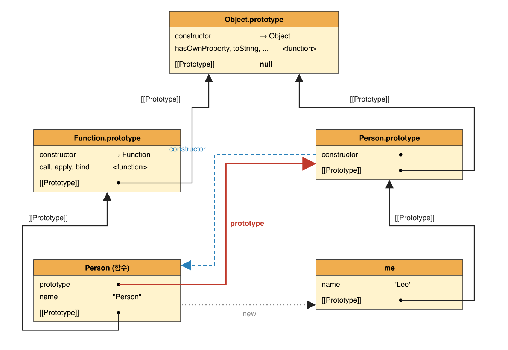

# 프로토타입

### 객체지향 프로그래밍

- 프로그램을 독립적 단위인 객체의 집합으로 표현하는 패러다임. 실체의 여러 속성 중 프로그램에 필요한 것만 추려 내는 것을 추상화라고 한다.
- 객체 = 상태(프로퍼티) + 상태를 조작하는 동작(메서드)을 하나로 묶을 복합 자료구조
- 자바스크립트는 클래스 기반이 아닌 프로토타입 기반 객체지향 언어다. 원시 값을 뺀 나머지는 전부 객체다.
- ES6 클래스는 새 모델이 아니라 프로토타입 패턴의 문법적 설탕이되, 생성자 함수보다 엄격하고 추가 기능이 있다.

### 상속이 왜 필요한가

```js
function Circle(radius) {
  this.radius = radius;
  this.getArea = function () {
    return Math.PI * this.radius ** 2;
  };
}
const c1 = new Circle(10),
  c2 = new Circle(2);
c1.getArea === c2.getArea; // false. 인스턴스마다 같은 함수가 따로 만들어짐
```

인스턴스 10개면 똑같은 getArea 함수가 10개 생긴다. 메모리 낭비다.

```js
function Circle(radius) {
  this.radius = radius;
}
Circle.prototype.getArea = function () {
  return Math.PI * this.radius ** 2;
};

const c1 = new Circle(10),
  c2 = new Circle(2);
c1.getArea === c2.getArea; // true 하나를 공유
```

radius 같은 상태는 인스턴스가 각자 갖고, getArea 같은 동작은 프로토타입에 하나만 두고 공유한다. 이게 상속이다.

### 프로토타입 객체

모든 객체는 [[Prototype]] 내부 슬롯을 갖는다. 여기에는 그 객체를 만든 생성자 함수의 prototype이 들어 있다.

```js
const me = new Person("Lee");
Object.getPrototypeOf(me) === Person.prototype; // true. 이 객체가 me의 부모
Object.getPrototypeOf(me) === Person; // false. 함수 자체가 들어가는 게 아님
```

| 만든 방법                | 부모             |
| ------------------------ | ---------------- |
| 객체 리터럴 {}           | Object.prototype |
| 생성자 함수 new Person() | Person.prototype |

객체, 프로토타입, 생성자 함수는 서로 연결돼 있다.

```js
Person(생성자 함수) --prototype--> Person.prototype --constructor--> Person
me(인스턴스) --__proto__--> Person.prototype
```

### `__proto__` 접근자 프로퍼티

[[Prototype]] 슬롯은 코드에서 직접 못 건드린다. 대신 `__proto__`로 읽고 쓴다.

- `__proto__`는 각 객체가 가진 게 아니라 Object.prototype에 있는 접근자를 상속받아 쓰는 것이다. 그래서 person.hasOwnProperty('_proto_')는 false다.
- 접근자로 만든 이유는 순환 참조를 막기 위해서다. 프로토타입 체인은 한 방향으로만 가야 하는데, 아무 검사 없이 교체를 허용하면 서로가 서로의 부모가 되어 프로퍼티 검색이 무한 루프에 빠진다. setter가 이걸 검사해서 타입에러를 낸다.

```js
const parent = {},
  child = {};
child.__proto__ = parent;
parent.__proto__ = child; // TypeError: Cyclic __proto__ value
```

- 코드에서 `__proto__`를 직접 쓰는 건 권장하지 않는다. Object.create(null)로 만든 객체는 Object.prototype을 상속하지 않아서 `__proto__`가 없다. 읽을 땐 Object.getPrototypeOf, 바꿀 땐 Object.setPrototypeOf를 쓴다.

### 함수의 prototype 프로퍼티

- 함수만 갖는다. 이 함수가 new로 만들 인스턴스의 부모가 될 객체를 담고 있다.
- 화살표 함수, 메서드 축약 표현은 new를 못 쓰므로 prototype 프로퍼티도 없다.
  | | 누가 갖나 | 용도 |
  | --- | --- | --- |
  | `__proto__` | 모든 객체 | 부모한테서 받은 것. 내 부모를 가리킴 |
  | prototype | 함수만 | 내 것. 내가 만들 인스턴스의 부모로 줄 객체 |

### 프로토타입의 constructor 프로퍼티

```js
function Person(name) {
  this.name = name;
}
const me = new Person("Kim");
Person.prototype === me.__proto__; // true
```

모든 프로토타입은 constructor를 갖고, 자기를 만든 생성자 함수를 가리킨다. 함수가 만들어질 때 같이 연결된다. me에는 constructor가 없지만 체인으로 상속받아 me.constructor === Person이 true다.

### 리터럴로 만든 객체의 생성자 함수

{}로 만든 객체도 obj.constructor === Object다. 객체 리터럴 평가와 new Object()는 세부 과정이 다르지만, 둘 다 OrdinaryObjectCreate로 객체를 만들고 결과물의 특성은 같다. 리터럴로 만든 객체도 상속을 위해 프로토타입이 필요하고, 프로토타입과 생성자 함수는 항상 쌍으로 존재하므로 리터럴 객체도 생성자 함수를 갖는다고 보면 된다.
| 리터럴 | 생성자 함수 | 프로토타입 |
| --- | --- | --- |
| {} | Object | Object.prototype |
| function(){} | Function | Function.prototype |
| [] | Array | Array.prototype |
| /regex/ | RegExp | RegExp.prototype |

### 프로토타입은 언제 생기나

생성자 함수가 만들어질 때 같이 만들어진다.

- 사용자 정의 함수: 함수 선언문은 코드 실행 전에 평가되어 함수 객체가 되고, 그때 프로토타입도 만들어져 prototype에 연결된다. 만들어진 프로토타입은 constructor 하나만 가진 객체이고, 그 객체의 부모는 Object.prototype이다.
- 빌트인 생성자 함수(Object, Array, String 등): 전역 객체가 만들어질 때 같이 만들어진다.

그래서 어떤 객체를 만들기 전에 이미 생성자 함수와 프로토타입이 존재하고, 객체를 만들면 그 프로토타입이 객체의 [[Prototype]]에 들어간다.

### 객체 생성 방식별 프로토타입

객체 리터럴, Object 생성자, 생성자 함수, Object.create, 클래스 어떤 방식이든 결국 OrdinaryObjectCreate라는 추상 연산이 객체를 만들고, 이 연산에 인수로 넘긴 프로토타입이 객체의 부모가 된다. 어떤 인수가 넘어가는지가 방식마다 다를 뿐이다.

- 객체 리터럴, Object 생성자 -> Object.prototype
- 생성자 함수 -> 그 함수의 prototype 객체

Person.prototype에는 처음엔 constructor뿐이지만, 메서드를 추가하면 이미 만든 인스턴스까지 전부 바로 상속받는다.

```js
Person.prototype.sayHello = function () {
  console.log(`Hi ! ${this.name}`);
};
me.sayHello(); // Hi! Kim
```

### 프로토타입 체인

객체에서 프로퍼티를 찾을 때 없으면 [[Prototype]]을 따라 부모로 올라가며 찾는다. 이게 프로토타입 체인이고, 자바스크립트가 상속을 구현하는 방식이다.

```js
me.hasOwnProperty("name");
// 1. me에 있나? 없음
// 2. Person.prototype에 있나? 없음
// 3. Object.prototype에 있나? 있음 -> 호출. 이때 this는 me
```

- 체인의 끝은 항상 Object.prototype이다. 그 부모는 null
- 끝까지 가도 없으면 에러가 아니라 undefined를 돌려준다.
- 프로토타입 체인은 프로퍼티를 찾는 것이고, 스코프 체인은 식별자(변수 이름)를 찾는 것이다.

### 오버라이딩과 프로퍼티 섀도잉

프로토타입에 있는 것과 같은 이름을 인스턴스에 추가하면, 프로토타입 것을 바꾸는 게 아니라 인스턴스에 새로 생긴다.

```js
Person.prototype.sayHello = function () {
  console.log("Hi");
};
me.sayHello = function () {
  console.log("Hey");
};
me.sayHello(); // Hey. 인스턴스 것이 호출됨
```

인스턴스 메서드가 프로토타입 메서드를 오버라이딩했고, 프로토타입 메서드는 섀도잉(가려짐)됐다.

인스턴스를 통해서는 프로토타입의 프로퍼티를 읽을 수만 있고 바꾸거나 지울 수 없다.

```js
delete me.sayHello; // 인스턴스 sayHello 삭제
me.sayHello(); // Hi. 프로토타입 sayHello가 다시 보임
delete me.sayHello; // 프로토타입 것은 안 지워짐
me.sayHello(); // Hi
```

바꾸려면 Person.prototype.sayHello = ...처럼 프로토타입에 직접 접근해야 한다.

### 프로토타입 교체

프로토타입은 다른 객체로 바꿀 수 있다. 바꾸는 방법이 두 가지인데, 어느 쪽이든 constructor 연결이 끊어진다는 공통 문제가 있고, 생성자 함수의 prototype이 새 객체를 가리키느냐에서 차이가 난다.

1. 생성자 함수의 prototype 프로퍼티 교체

```js
function Person(name) {
  this.name = name;
}

Person.prototype = {
  // Person이 들고 있던 { constructor: Person }을 버리고
  sayHello() {
    console.log("Hi");
  }, // 이 객체로 바꿔 끼움
};

const me = new Person("Lee");
```

Person 함수 자체는 그대로다. Person이 "new 할 때 인스턴스에게 줄 객체"로 들고 있던 Person.prototype만 바뀌었다.
그래서 그 뒤에 만든 me의 부모는 새 객체 { sayHello }다.

```js
me.sayHello(); // Hi
Object.getPrototypeOf(me) === Person.prototype // true
me instanceOf Person // true

me.constructor === Person // false
me.constructor === Object // true
```

문제는 새로 넣은 객체에 constructor가 없다는 것이다. 원래 Person.prototype에는 엔진이 constructor: Person을 넣어 뒀는데, 내가 만든 리터럴에는 그게 없다. 그래서 me.constructor는 me -> 새 Person.prototype(없음) -> Object.prototype(있음) 순으로 찾아 Object가 나온다.

상속은 멀쩡하고 "나를 만든 함수가 누구냐"만 달라진 것이다. 되살리려면 리터럴에 직접 넣는다.

```js
Person.prototype = {
  constructor: Person,
  sayHello() {
    console.log("Hi");
  },
};
```

2. 인스턴스의 `__proto__` 교체

```js
function Person(name) {
  this.name = name;
}
const me = new Person("Lee"); // 이 시점 me의 부모는 Person.prototype

const parent = {
  sayHello() {
    console.log("Hi");
  },
};

Object.setPrototypeOf(me, parent); // me.__proto__ = parent
me.sayHello(); // Hi
```

이미 만들어진 me의 부모를 parent로 바꾼 것이다. parent는 함수가 아니니 parent.prototype 같은 건 없고, parent 그 자체가 me의 부모가 된다.
여기서도 parent에 constructor가 없으니 me.constructor는 Object가 나온다.

이렇게 손이 많이 가고 실수하기 쉬워서 프로토타입은 직접 교체하지 않는 편이 나은 것 같다. 상속 관계가 필요하면 Object.create나 클래스를 쓰자.

### instanceof

우변 함수의 prototype 객체가 좌변 객체의 프로토타입 체인에 있으면 true다. constructor를 보는 게 아니다.

```js
const me = new Person("Lee");
me instanceof Person; // true 체인에 Person.prototype이 있음

Object.setPrototypeOf(me, {});
me instanceof Person; // false 체인에서 Person.prototype이 빠짐

Person.prototype = {}; // (위와 별개로) 생성자로 교체해 constructor가 끊겨도
me instanceof Person; // 영향 없음. 체인에 Person.prototype이 있기만 하면 됨
```

### 직접 상속 Object.create

프로토타입을 직접 지정해서 객체를 만든다. 첫 번째 인수가 부모, 두 번째(생략가능)가 프로퍼티 디스크립터

```js
Object.create(null); // 부모 없음
Object.create(Object.prototype); // {}와 같음
Object.create(Person.prototype); // new Person()과 같은 체인
```

### 정적 프로퍼티/메서드

생성자 함수 자체에 붙인 프로퍼티. 인스턴스를 안 만들어도 쓸 수 있다.

```js
Person.staticMethod = function () {};
Person.staticMethod(); // 됨
me.staticMethod(); // TypeError. me의 프로토타입 체인에 없음
```

### 프로퍼티 존재 확인

|                         | 자기 것 | 상속받은 것 |
| ----------------------- | ------- | ----------- |
| key in obj              | O       | O           |
| Reflect.has(obj, key)   | O       | O           |
| obj.hasOwnProperty(key) | O       | X           |

### 프로퍼티 열거

1. for...in
   프로토타입 체인 전체에서 enumerable이 true인 프로퍼티를 순회한다.

- toString은 enumerable:false라 안 나온다.
- `__proto__`: { age: 20 }의 age는 상속받은 것이지만 enumerable이라 나온다.
- 심벌 키는 안 나온다.
- 자기 것만 보려면 안에서 hasOwnProperty로 거른다.
- 배열에는 쓰지 않는다. 배열에 붙인 프로퍼티까지 나온다.

```js
const arr = [1, 2, 3];
arr.x = 10; // 배열도 객체라 이게 됨. 요소는 아님

for (const k in arr) console.log(k, arr[k]);
// "0" 1
// "1" 2
// "2" 3
// "x" 10

arr.length; // 3  x는 length에 안 잡힘
```

세 가지 문제가 겹친다.

- 요소가 아닌 프로퍼티가 섞인다. 위의 x처럼
- 상속받은 것까지 나온다. 누가 Array.prototype.extra = function(){}을 해 두면 모든 배열의 for...in에 "extra"까지 나온다
- 키가 문자열이다. "0", "1"이지 숫자 0, 1이 아니다. k + 1을 하면 "01"이 된다.

2. Object.keys / values/ entries
   자기 자신의 enumerable 프로퍼티만

```js
const person = {
  name: "Lee",
  address: "Seoul",
  __proto__: { age: 20 },
};
Object.keys(person); // ['name', 'address']
Object.values(person); // ['Lee', 'Seoul']
Object.entries(person); // [['name', 'Lee'], ['address', 'Seoul']]
```

### Person, Person.prototype, me를 한 그림에


코드로 쓰면 이렇다

```js
// me(인스턴스)
me.__proto__ === Person.prototype; // true
Person.prototype.__proto__ === Object.prototype; // true
Object.prototype.__proto__; // null

// Person(함수)
Person.__proto__ === Function.prototype; // true
Function.prototype.__proto__ === Object.prototype; // true

// prototype과 constructor는 서로 가리킴
Person.prototype.constructor === Person; // true
```

- 부모는 "누가 만들었냐"로 정해진다. new X()로 만든 객체의 부모는 X.prototype이다.
- {}는 new Object()라서 부모가 Object.prototype, 함수는 new Function()이라서 부모가 Function.prototype이다.
- X.prototype은 X가 만들 인스턴스의 부모. `X.__proto__`는 X 자신의 부모. 둘은 다른 객체다.
- 모든 체인은 Object.prototype에서 끝난다. 그 부모는 null(부모가 없어서 null임 null은 객체도 아니고 "부모칸은 비어있음"이라는 뜻)
