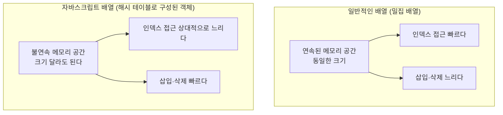
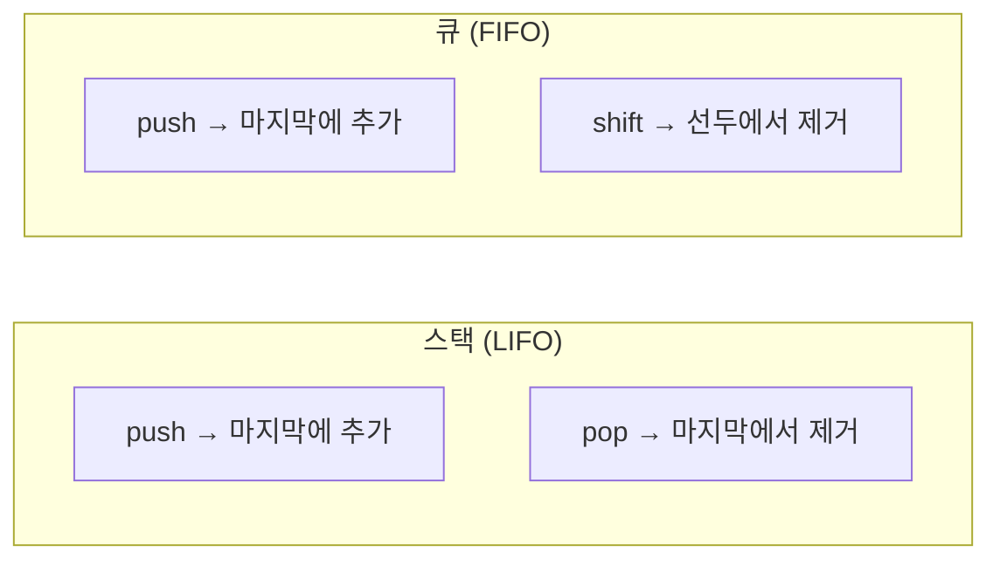
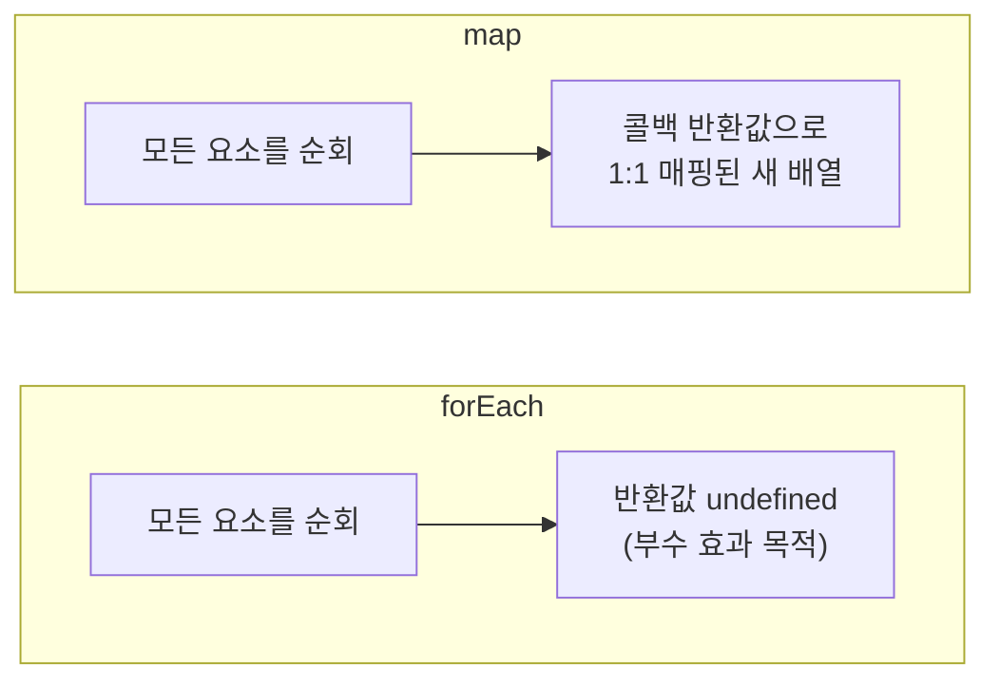
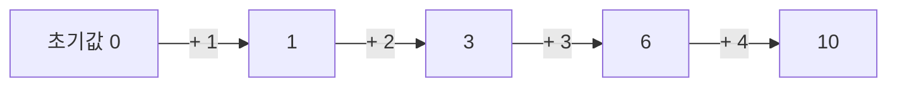

### 배열이란?

- **배열(array)** 은 **여러 개의 값을 순차적으로 나열한 자료구조**다.
  - ```javascript
    const arr = ["apple", "banana", "orange"];
    ```
- 배열이 가지고 있는 값을 **요소(element)** 라 한다.
  - 자바스크립트의 모든 값은 배열의 요소가 될 수 있다.
    - 원시값은 물론 객체, 함수, 배열 등 **어떤 값이라도 배열의 요소**가 될 수 있다.
  - ```javascript
    const arr = [1, "string", { x: 1 }, [1, 2], function () {}, null];
    ```
- 배열의 요소는 배열에서 자신의 위치를 나타내는 **0 이상의 정수인 인덱스(index)** 를 갖는다.
  - 인덱스는 배열의 요소에 접근할 때 사용하며 **0부터 시작**한다.
  - ```javascript
    const arr = ["apple", "banana", "orange"];

    arr[0]; // 'apple'
    arr[1]; // 'banana'
    arr[2]; // 'orange'
    ```
- 배열은 요소의 개수, 즉 **배열의 길이를 나타내는 `length` 프로퍼티**를 갖는다.
  - ```javascript
    arr.length; // 3
    ```
  - 따라서 `for` 문을 사용하여 **순차적으로 요소에 접근**할 수 있다.
  - ```javascript
    for (let i = 0; i < arr.length; i++) {
      console.log(arr[i]); // 'apple' 'banana' 'orange'
    }
    ```
- 배열은 **인덱스와 `length` 프로퍼티를 갖기 때문에 반복문을 통해 순차적으로 값에 접근하기 적합**한 자료구조다.
- 자바스크립트에 **배열이라는 타입은 존재하지 않는다**.
  - **배열은 객체 타입**이다.
  - ```javascript
    typeof [] === "object"; // true
    ```
- 배열은 **배열 리터럴, `Array` 생성자 함수, `Array.of`, `Array.from` 메서드**로 생성할 수 있다.
  - 배열의 생성자 함수는 `Array`이며, 배열의 프로토타입 객체는 `Array.prototype`이다. ([19장](../../week07/윤홍비/19.프로토타입.md#프로토타입-객체))
  - `Array.prototype`은 배열을 위한 **빌트인 메서드를 제공**한다.
  - ```javascript
    const arr = [1, 2, 3];

    arr.constructor === Array; // true
    Object.getPrototypeOf(arr) === Array.prototype; // true
    ```
- 배열은 객체지만 **일반 객체와는 구별되는 특징**이 있다.

| 구분            | 객체                   | 배열          |
| --------------- | ---------------------- | ------------- |
| 구조            | 프로퍼티 키와 프로퍼티 값 | 인덱스와 요소 |
| 값의 참조       | 프로퍼티 키            | 인덱스        |
| 값의 순서       | ✕                      | ○             |
| `length` 프로퍼티 | ✕                    | ○             |

- 일반 객체와 배열을 구분하는 가장 명확한 차이는 **"값의 순서"와 "`length` 프로퍼티"** 다.
  - 인덱스로 **순서대로 접근**할 수 있고 **길이를 갖기 때문에** 반복문으로 순차 접근, 역순 접근, 특정 위치부터 접근이 모두 가능하다.

### 자바스크립트 배열은 배열이 아니다

- **자료구조에서 말하는 배열**은 **동일한 크기의 메모리 공간이 빈틈없이 연속적으로 나열된 자료구조**를 말한다.
  - 이러한 배열을 **밀집 배열(dense array)** 이라 한다.
  - 각 요소가 동일한 데이터 크기를 가지며 빈틈없이 연속적으로 이어져 있으므로 **인덱스를 통해 단 한 번의 연산으로 임의의 요소에 접근**할 수 있다. (**임의 접근, random access**)
    - 검색 대상 요소의 메모리 주소 = 배열의 시작 메모리 주소 + 인덱스 \* 요소의 바이트 수
  - 하지만 **정렬되지 않은 배열에서 특정 요소를 검색**하는 경우 모든 요소를 처음부터 확인해야 한다. (**선형 검색, linear search**)
  - 또한 요소를 **삽입하거나 삭제하는 경우 연속성을 유지하기 위해 요소를 이동**시켜야 한다.
- **자바스크립트의 배열은 일반적인 의미의 배열이 아니다**.
  - 배열의 요소를 위한 **각각의 메모리 공간은 동일한 크기를 갖지 않아도 되며**, **연속적으로 이어져 있지 않을 수도 있다**.
  - 이처럼 배열의 요소가 연속적으로 이어져 있지 않은 배열을 **희소 배열(sparse array)** 이라 한다.
- 즉 **자바스크립트의 배열은 일반적인 배열의 동작을 흉내 낸 특수한 객체**다.
  - ```javascript
    // 배열의 프로퍼티 어트리뷰트를 확인해보면 인덱스가 프로퍼티 키인 객체임을 알 수 있다
    console.log(Object.getOwnPropertyDescriptors([1, 2, 3]));
    /*
    {
      '0': { value: 1, writable: true, enumerable: true, configurable: true },
      '1': { value: 2, writable: true, enumerable: true, configurable: true },
      '2': { value: 3, writable: true, enumerable: true, configurable: true },
      length: { value: 3, writable: true, enumerable: false, configurable: false }
    }
    */
    ```
  - 자바스크립트 배열은 **인덱스를 나타내는 문자열을 프로퍼티 키로 가지며, `length` 프로퍼티를 갖는 특수한 객체**다. ([16장](../../week06/윤홍비/16.프로퍼티_어트리뷰트.md))
  - 자바스크립트 배열의 요소는 **사실 프로퍼티 값**이다. 따라서 어떤 타입의 값이라도 요소가 될 수 있다.



- 일반적인 배열과 자바스크립트 배열의 **장단점은 서로 트레이드오프 관계**다.
  - 인덱스로 요소에 접근하는 경우 **일반적인 배열보다 느릴 수밖에 없는 구조적 단점**이 있다.
  - 대신 특정 요소를 **삽입 또는 삭제하는 경우에는 일반적인 배열보다 빠른 성능**을 기대할 수 있다.
- 이러한 단점을 보완하기 위해 모던 자바스크립트 엔진은 **배열을 일반 객체와 구분하여 더 배열처럼 동작하도록 최적화**하여 구현했다.
  - ```javascript
    const arr = [];

    console.time("Array Performance Test");
    for (let i = 0; i < 10000000; i++) {
      arr[i] = i;
    }
    console.timeEnd("Array Performance Test"); // 약 340ms

    const obj = {};

    console.time("Object Performance Test");
    for (let i = 0; i < 10000000; i++) {
      obj[i] = i;
    }
    console.timeEnd("Object Performance Test"); // 약 600ms
    ```
  - 즉 배열이 일반 객체보다 **약 2배 정도 빠르다**.

### length 프로퍼티와 희소 배열

- `length` 프로퍼티는 **요소의 개수, 즉 배열의 길이를 나타내는 0 이상의 정수**를 값으로 갖는다.
  - ```javascript
    [].length; // 0
    [1, 2, 3].length; // 3
    ```
- `length` 프로퍼티의 값은 **배열에 요소를 추가하거나 삭제하면 자동 갱신**된다.
  - ```javascript
    const arr = [1, 2, 3];
    console.log(arr.length); // 3

    arr.push(4);
    console.log(arr.length); // 4

    arr.pop();
    console.log(arr.length); // 3
    ```
- `length` 프로퍼티의 값은 **요소의 개수를 바탕으로 결정되지만 명시적으로 할당할 수도 있다**.
  - 현재 `length` 프로퍼티 값보다 **작은 숫자 값을 할당하면 배열의 길이가 줄어든다**.
  - ```javascript
    const arr = [1, 2, 3, 4, 5];

    arr.length = 3;
    console.log(arr); // [1, 2, 3]
    ```
  - 현재 `length` 프로퍼티 값보다 **큰 숫자 값을 할당하면 `length` 값은 변경되지만 배열의 길이가 늘어나지는 않는다**.
  - ```javascript
    const arr = [1];

    arr.length = 3;

    // length 프로퍼티 값은 변경되지만 실제로 배열의 길이가 늘어나지는 않는다
    console.log(arr.length); // 3
    console.log(arr); // [1, empty × 2]
    ```
  - `empty × 2`는 **실제로 추가된 배열의 요소가 아니다**. 즉 `arr[1]`과 `arr[2]`에는 값이 존재하지 않는다.
- 이처럼 배열의 요소가 **연속적으로 위치하지 않고 일부가 비어 있는 배열**을 **희소 배열**이라 한다.
  - 자바스크립트는 희소 배열을 **문법적으로 허용**한다.
  - ```javascript
    // 희소 배열
    const sparse = [, 2, , 4];

    // 희소 배열의 length는 배열의 실제 요소 개수보다 언제나 크다
    console.log(sparse.length); // 4
    console.log(sparse); // [empty, 2, empty, 4]

    // 존재하지 않는 요소를 가리키는 프로퍼티는 존재하지 않는다
    console.log(Object.getOwnPropertyDescriptors(sparse));
    /*
    {
      '1': { value: 2, writable: true, enumerable: true, configurable: true },
      '3': { value: 4, writable: true, enumerable: true, configurable: true },
      length: { value: 4, writable: true, enumerable: false, configurable: false }
    }
    */
    ```
  - 일반적인 배열의 `length`는 **배열 요소의 개수, 즉 배열의 길이와 언제나 일치**한다.
  - 하지만 **희소 배열은 `length`와 배열 요소의 개수가 일치하지 않는다**. 희소 배열의 `length`는 **실제 요소 개수보다 언제나 크다**.
- 자바스크립트는 희소 배열을 허용하지만 **희소 배열은 사용하지 않는 것이 좋다**.
  - 희소 배열은 **연속적인 값의 집합이라는 배열의 기본적인 개념에 위배**되며 **성능에도 좋지 않은 영향**을 준다.
  - 배열에는 **같은 타입의 요소를 연속적으로 위치시키는 것이 최선**이다.

### 배열 생성

#### 배열 리터럴

- **배열 리터럴**은 **0개 이상의 요소를 쉼표로 구분하여 대괄호 `[]`로 묶는다**.
  - 배열 리터럴은 객체 리터럴과 달리 **프로퍼티 키가 없고 값만 존재**한다.
  - ```javascript
    const arr = [1, 2, 3];
    console.log(arr.length); // 3
    ```
- 배열 리터럴에 요소를 하나도 추가하지 않으면 **빈 배열**이 된다.
  - ```javascript
    const arr = [];
    console.log(arr.length); // 0
    ```
- 배열 리터럴에 요소를 생략하면 **희소 배열**이 생성된다.
  - ```javascript
    const arr = [1, , 3];

    console.log(arr.length); // 3
    console.log(arr); // [1, empty, 3]
    console.log(arr[1]); // undefined
    ```
  - `arr[1]`이 `undefined`인 이유는 **프로퍼티 값이 `undefined`여서가 아니라 `1`이라는 프로퍼티 자체가 존재하지 않기 때문**이다. ([19장](../../week07/윤홍비/19.프로토타입.md#프로토타입-체인))

#### Array 생성자 함수

- `Object` 생성자 함수를 통해 객체를 생성할 수 있듯이 **`Array` 생성자 함수를 통해 배열을 생성**할 수도 있다.
  - `Array` 생성자 함수는 **전달된 인수의 개수에 따라 다르게 동작**하므로 주의가 필요하다.
- 전달된 인수가 **1개이고 숫자인 경우 `length` 프로퍼티 값이 인수인 배열을 생성**한다.
  - ```javascript
    const arr = new Array(10);

    console.log(arr); // [empty × 10]
    console.log(arr.length); // 10
    ```
  - 이때 생성된 배열은 **희소 배열**이다. `length` 프로퍼티 값은 `10`이지만 실제로 **배열의 요소는 존재하지 않는다**.
  - ```javascript
    console.log(Object.getOwnPropertyDescriptors(arr));
    /*
    {
      length: { value: 10, writable: true, enumerable: false, configurable: false }
    }
    */
    ```
  - 배열은 **요소를 최대 `2 ** 32 - 1`(4,294,967,295)개 가질 수 있다**. 따라서 범위를 벗어나면 에러가 발생한다.
  - ```javascript
    new Array(4294967295); // 가장 큰 length 값
    new Array(4294967296); // RangeError: Invalid array length
    new Array(-1); // RangeError: Invalid array length
    ```
- 전달된 인수가 **없는 경우 빈 배열을 생성**한다. 즉 배열 리터럴 `[]`와 같다.
  - ```javascript
    new Array(); // []
    ```
- 전달된 인수가 **2개 이상이거나 숫자가 아닌 경우 인수를 요소로 갖는 배열을 생성**한다.
  - ```javascript
    new Array(1, 2, 3); // [1, 2, 3]
    new Array({}); // [{}]
    ```
- `Array` 생성자 함수는 `new` 연산자와 함께 호출하지 않아도, **즉 일반 함수로서 호출해도 배열을 생성하는 생성자 함수로 동작**한다.
  - `Array` 생성자 함수 내부에서 `new.target`을 확인하기 때문이다. ([17장](../../week07/윤홍비/17.생성자함수에_의한_객체생성.md))
  - ```javascript
    Array(1, 2, 3); // [1, 2, 3]
    ```

#### Array.of

- ES6에서 도입된 **`Array.of` 메서드는 전달된 인수를 요소로 갖는 배열을 생성**한다.
  - `Array` 생성자 함수와 다르게 **전달된 인수가 1개이고 숫자이더라도 인수를 요소로 갖는 배열을 생성**한다.
  - ```javascript
    Array.of(1); // [1]
    Array.of(1, 2, 3); // [1, 2, 3]
    Array.of("string"); // ['string']
    ```
  - 즉 `Array` 생성자 함수의 **헷갈리는 동작을 보완**하기 위해 도입되었다.

#### Array.from

- ES6에서 도입된 **`Array.from` 메서드는 유사 배열 객체 또는 이터러블 객체를 인수로 전달받아 배열로 변환하여 반환**한다.
  - ```javascript
    // 유사 배열 객체를 변환하여 배열을 생성한다
    Array.from({ length: 2, 0: "a", 1: "b" }); // ['a', 'b']

    // 이터러블을 변환하여 배열을 생성한다 (문자열은 이터러블이다)
    Array.from("Hello"); // ['H', 'e', 'l', 'l', 'o']
    ```
- `Array.from`을 사용하면 **두 번째 인수로 전달한 콜백 함수를 통해 값을 만들면서 요소를 채울 수 있다**.
  - 콜백 함수는 **첫 번째 인수로 요소값, 두 번째 인수로 인덱스**를 전달받는다.
  - ```javascript
    // length만 존재하는 유사 배열 객체를 전달하면 undefined를 요소로 채운다
    Array.from({ length: 3 }); // [undefined, undefined, undefined]

    // 콜백 함수의 반환값으로 구성된 배열을 반환한다
    Array.from({ length: 3 }, (_, i) => i); // [0, 1, 2]
    ```
  - 이를 이용하면 **희소 배열이 아닌 배열을 간단하게 생성**할 수 있다. `new Array(3)`과 달리 요소가 실제로 존재한다.

##### 유사 배열 객체와 이터러블 객체

- **유사 배열 객체(array-like object)** 는 **마치 배열처럼 인덱스로 프로퍼티 값에 접근할 수 있고 `length` 프로퍼티를 갖는 객체**다.
  - 유사 배열 객체는 **배열이 아니므로 배열 메서드를 사용할 수 없다**.
  - ```javascript
    const arrayLike = {
      0: "apple",
      1: "banana",
      length: 2,
    };

    // 인덱스로 프로퍼티 값에 접근할 수 있다
    for (let i = 0; i < arrayLike.length; i++) {
      console.log(arrayLike[i]); // 'apple' 'banana'
    }

    // 배열 메서드를 사용할 수 없다
    arrayLike.map((v) => v); // TypeError: arrayLike.map is not a function
    ```
  - 대표적인 유사 배열 객체로 `arguments` 객체가 있다. ([18장](../../week05/윤홍비/18.함수와_일급_객체.md#arguments-프로퍼티))
- **이터러블 객체(iterable object)** 는 **`Symbol.iterator` 메서드를 구현하여 `for...of` 문으로 순회할 수 있는 객체**다.
  - ES6에서 제공하는 **빌트인 이터러블**은 `Array`, `String`, `Map`, `Set`, `arguments`, `NodeList`, `HTMLCollection` 등이 있다.
- `arguments`, `NodeList`, `HTMLCollection`은 **유사 배열 객체이면서 이터러블**이다.
  - ES6에서 이터러블이 도입되면서 이들에 `Symbol.iterator` 메서드가 추가되었기 때문이다.
  - 따라서 **스프레드 문법이나 `Array.from`으로 손쉽게 배열로 변환**할 수 있다.

### 배열 요소의 참조

- 배열의 요소를 참조할 때에는 **대괄호 `[]` 표기법**을 사용한다.
  - 대괄호 안에는 **인덱스**가 와야 한다. 인덱스는 **객체의 프로퍼티 키와 같은 역할**을 한다.
  - ```javascript
    const arr = [1, 2];

    console.log(arr[0]); // 1
    console.log(arr[1]); // 2
    ```
- 존재하지 않는 요소에 접근하면 **`undefined`를 반환**한다.
  - ```javascript
    console.log(arr[2]); // undefined
    ```
  - 배열은 **사실 인덱스를 프로퍼티 키로 갖는 객체**이므로, 존재하지 않는 프로퍼티에 접근했을 때와 마찬가지로 `undefined`를 반환한다.
- 따라서 **희소 배열의 존재하지 않는 요소를 참조해도 `undefined`가 반환**된다.
  - ```javascript
    const sparse = [1, , 3];

    console.log(Object.getOwnPropertyDescriptors(sparse));
    /*
    {
      '0': {value: 1, ...},
      '2': {value: 3, ...},
      length: {value: 3, ...}
    }
    */

    // 존재하지 않는 프로퍼티 '1'에 접근하면 undefined를 반환한다
    console.log(sparse[1]); // undefined
    ```

### 배열 요소의 추가와 갱신

- 객체에 프로퍼티를 동적으로 추가할 수 있는 것처럼 **배열에도 요소를 동적으로 추가**할 수 있다.
  - 존재하지 않는 인덱스를 사용해 값을 할당하면 **새로운 요소가 추가**되고 `length` 프로퍼티 값이 **자동으로 갱신**된다.
  - ```javascript
    const arr = [0];

    arr[1] = 1;

    console.log(arr); // [0, 1]
    console.log(arr.length); // 2
    ```
- 만약 **현재 배열의 `length` 프로퍼티 값보다 큰 인덱스로 요소를 추가하면 희소 배열**이 된다.
  - ```javascript
    arr[100] = 100;

    console.log(arr); // [0, 1, empty × 98, 100]
    console.log(arr.length); // 101
    ```
  - 이때 인덱스로 요소에 접근하여 명시적으로 값을 할당하지 않은 요소는 **생성되지 않는다**.
  - ```javascript
    console.log(Object.getOwnPropertyDescriptors(arr));
    /*
    {
      '0': {value: 0, ...},
      '1': {value: 1, ...},
      '100': {value: 100, ...},
      length: {value: 101, ...}
    }
    */
    ```
- 이미 요소가 존재하는 인덱스에 값을 재할당하면 **요소값이 갱신**된다.
  - ```javascript
    arr[1] = 10;
    console.log(arr[1]); // 10
    ```
- 인덱스는 **요소의 위치를 나타내므로 반드시 0 이상의 정수(또는 정수 형태의 문자열)** 를 사용해야 한다.
  - 정수 이외의 값을 인덱스처럼 사용하면 **요소가 아닌 프로퍼티가 생성**된다.
  - 이때 추가된 프로퍼티는 **`length` 프로퍼티 값에 영향을 주지 않는다**.
  - ```javascript
    const arr = [];

    arr[0] = 1;
    arr["1"] = 2;

    // 프로퍼티가 추가된다
    arr["foo"] = 3;
    arr.bar = 4;
    arr[1.1] = 5;
    arr[-1] = 6;

    console.log(arr); // [1, 2, foo: 3, bar: 4, '1.1': 5, '-1': 6]

    // 프로퍼티는 length에 영향을 주지 않는다
    console.log(arr.length); // 2
    ```

### 배열 요소의 삭제

- 배열은 **사실 객체이기 때문에 배열의 특정 요소를 삭제하기 위해 `delete` 연산자를 사용**할 수 있다.
  - ```javascript
    const arr = [1, 2, 3];

    // 배열 요소의 삭제
    delete arr[1];
    console.log(arr); // [1, empty, 3]

    // length 프로퍼티에 영향을 주지 않는다. 즉 희소 배열이 된다
    console.log(arr.length); // 3
    ```
  - `delete` 연산자는 **객체의 프로퍼티를 삭제**한다. 따라서 **희소 배열이 되며 `length`는 변하지 않는다**.
  - 즉 **`delete` 연산자는 사용하지 않는 것이 좋다**.
- 희소 배열을 만들지 않으면서 배열의 특정 요소를 완전히 삭제하려면 **`Array.prototype.splice` 메서드를 사용**한다.
  - ```javascript
    const arr = [1, 2, 3];

    // Array.prototype.splice(삭제를 시작할 인덱스, 삭제할 요소 수)
    arr.splice(1, 1);
    console.log(arr); // [1, 3]

    // length 프로퍼티가 자동 갱신된다
    console.log(arr.length); // 2
    ```

### 배열 메서드

- 자바스크립트는 **배열을 다룰 때 유용한 다양한 빌트인 메서드를 제공**한다.
  - `Array` 생성자 함수는 **정적 메서드**를 제공하고, 배열 객체의 프로토타입인 `Array.prototype`은 **프로토타입 메서드**를 제공한다. ([19장](../../week07/윤홍비/19.프로토타입.md#정적-프로퍼티메서드))
- 배열 메서드는 결과물을 반환하는 패턴이 **두 가지**이므로 주의가 필요하다.
  - **원본 배열(메서드를 호출한 배열, 즉 `this`)을 직접 변경하는 메서드(mutator method)**
  - **원본 배열을 직접 변경하지 않고 새로운 배열을 생성하여 반환하는 메서드(accessor method)**
- **원본 배열을 직접 변경하는 메서드는 외부 상태를 직접 변경하는 부수 효과가 있으므로 사용할 때 주의**해야 한다.
  - 따라서 가급적 **원본 배열을 직접 변경하지 않는 메서드를 사용하는 편이 좋다**.
  - ```javascript
    const arr = [1];

    // push는 원본 배열을 직접 변경한다
    arr.push(2);
    console.log(arr); // [1, 2]

    // concat은 원본 배열을 직접 변경하지 않고 새로운 배열을 생성하여 반환한다
    const result = arr.concat(3);
    console.log(arr); // [1, 2]
    console.log(result); // [1, 2, 3]
    ```

| 원본 배열을 직접 변경하는 메서드                               | 새로운 배열을 반환하는 메서드                                  |
| -------------------------------------------------------------- | -------------------------------------------------------------- |
| `push`, `pop`, `unshift`, `shift`, `splice`, `reverse`, `sort`, `fill` | `concat`, `slice`, `join`, `flat`, `map`, `filter` 등 |

#### Array.isArray

- **`Array.isArray`는 `Array` 생성자 함수의 정적 메서드**다.
  - 전달된 인수가 **배열이면 `true`, 배열이 아니면 `false`를 반환**한다.
  - ```javascript
    // true
    Array.isArray([]);
    Array.isArray([1, 2]);
    Array.isArray(new Array());

    // false
    Array.isArray();
    Array.isArray({});
    Array.isArray("Array");
    Array.isArray({ 0: 1, length: 1 });
    ```
  - `typeof` 연산자로는 배열과 객체를 구분할 수 없으므로 **배열 여부를 판별할 때 사용**한다.

#### Array.prototype.indexOf

- **`indexOf` 메서드는 원본 배열에서 인수로 전달된 요소를 검색하여 인덱스를 반환**한다.
  - **중복되는 요소가 여러 개 있다면 첫 번째로 검색된 요소의 인덱스**를 반환한다.
  - **존재하지 않으면 `-1`을 반환**한다.
  - ```javascript
    const arr = [1, 2, 2, 3];

    arr.indexOf(2); // 1
    arr.indexOf(4); // -1

    // 두 번째 인수는 검색을 시작할 인덱스다
    arr.indexOf(2, 2); // 2
    ```
- `indexOf` 메서드는 **배열에 특정 요소가 존재하는지 확인할 때 유용**하다.
  - ```javascript
    const foods = ["apple", "banana", "orange"];

    if (foods.indexOf("orange") === -1) {
      foods.push("orange");
    }
    ```
  - 다만 `indexOf` 대신 **ES7에서 도입된 `Array.prototype.includes` 메서드를 사용하면 가독성이 더 좋다**.
  - ```javascript
    if (!foods.includes("orange")) {
      foods.push("orange");
    }
    ```

#### Array.prototype.push

- **`push` 메서드는 인수로 전달받은 모든 값을 원본 배열의 마지막 요소로 추가하고 변경된 `length` 프로퍼티 값을 반환**한다.
  - **원본 배열을 직접 변경**한다.
  - ```javascript
    const arr = [1, 2];

    let result = arr.push(3, 4);
    console.log(result); // 4
    console.log(arr); // [1, 2, 3, 4]
    ```
- `push` 메서드는 성능 면에서 좋지 않다.
  - 마지막 요소로 추가할 요소가 하나뿐이라면 **`length` 프로퍼티를 사용하여 직접 추가하는 것이 더 빠르다**.
  - ```javascript
    arr[arr.length] = 5;
    console.log(arr); // [1, 2, 3, 4, 5]
    ```
- `push` 메서드는 **원본 배열을 직접 변경하는 부수 효과**가 있다.
  - 따라서 **ES6의 스프레드 문법을 사용하는 편이 좋다**. 함수 호출 없이 하나의 표현식으로 간결하게 표현할 수 있다.
  - ```javascript
    const arr = [1, 2];

    const newArr = [...arr, 3];
    console.log(arr); // [1, 2]
    console.log(newArr); // [1, 2, 3]
    ```

#### Array.prototype.pop

- **`pop` 메서드는 원본 배열에서 마지막 요소를 제거하고 제거한 요소를 반환**한다.
  - **원본 배열이 빈 배열이면 `undefined`를 반환**한다.
  - **원본 배열을 직접 변경**한다.
  - ```javascript
    const arr = [1, 2];

    let result = arr.pop();
    console.log(result); // 2
    console.log(arr); // [1]
    ```
- `pop`과 `push` 메서드를 사용하면 **스택(stack)** 을 쉽게 구현할 수 있다.
  - 스택은 **마지막에 밀어 넣은 데이터를 먼저 꺼내는 후입 선출(LIFO) 방식**의 자료구조다.
  - ```javascript
    const Stack = (function () {
      function Stack(array = []) {
        if (!Array.isArray(array)) {
          throw new TypeError(`${array} is not an array.`);
        }
        this.array = array;
      }

      Stack.prototype = {
        constructor: Stack,
        // 스택의 가장 마지막에 데이터를 밀어 넣는다
        push(value) {
          return this.array.push(value);
        },
        // 스택의 가장 마지막 데이터를 꺼낸다
        pop() {
          return this.array.pop();
        },
        entries() {
          return [...this.array];
        },
      };

      return Stack;
    })();

    const stack = new Stack([1, 2]);
    stack.push(3);
    console.log(stack.entries()); // [1, 2, 3]
    console.log(stack.pop()); // 3
    ```

#### Array.prototype.unshift

- **`unshift` 메서드는 인수로 전달받은 모든 값을 원본 배열의 선두에 요소로 추가하고 변경된 `length` 프로퍼티 값을 반환**한다.
  - **원본 배열을 직접 변경**한다.
  - ```javascript
    const arr = [1, 2];

    let result = arr.unshift(3, 4);
    console.log(result); // 4
    console.log(arr); // [3, 4, 1, 2]
    ```
  - 부수 효과가 있으므로 **스프레드 문법을 사용하는 편이 좋다**.
  - ```javascript
    const newArr = [3, ...arr];
    ```

#### Array.prototype.shift

- **`shift` 메서드는 원본 배열에서 첫 번째 요소를 제거하고 제거한 요소를 반환**한다.
  - **원본 배열이 빈 배열이면 `undefined`를 반환**한다.
  - **원본 배열을 직접 변경**한다.
  - ```javascript
    const arr = [1, 2];

    let result = arr.shift();
    console.log(result); // 1
    console.log(arr); // [2]
    ```
- `shift`와 `push` 메서드를 사용하면 **큐(queue)** 를 쉽게 구현할 수 있다.
  - 큐는 **먼저 밀어 넣은 데이터를 먼저 꺼내는 선입 선출(FIFO) 방식**의 자료구조다.



#### Array.prototype.concat

- **`concat` 메서드는 인수로 전달된 값들(배열 또는 값)을 원본 배열의 마지막 요소로 추가한 새로운 배열을 반환**한다.
  - 인수로 전달한 값이 **배열인 경우 배열을 해체하여 새로운 배열의 요소로 추가**한다.
  - **원본 배열은 변경되지 않는다**.
  - ```javascript
    const arr1 = [1, 2];
    const arr2 = [3, 4];

    let result = arr1.concat(arr2);
    console.log(result); // [1, 2, 3, 4]

    result = arr1.concat(3);
    console.log(result); // [1, 2, 3]

    result = arr1.concat(arr2, 5);
    console.log(result); // [1, 2, 3, 4, 5]

    // 원본 배열은 변경되지 않는다
    console.log(arr1); // [1, 2]
    ```
- `push`/`unshift` 메서드는 `concat` 메서드로 **대체할 수 있다**.
  - 다만 **`push`/`unshift`는 원본 배열을 직접 변경하지만 `concat`은 새로운 배열을 반환**한다는 차이가 있다.
  - ```javascript
    const arr1 = [3, 4];

    // push를 사용하는 경우 원본 배열을 변수에 저장해 두어야 한다
    arr1.unshift(1, 2);
    console.log(arr1); // [1, 2, 3, 4]

    // concat을 사용하는 경우 반환값을 반드시 변수에 할당받아야 한다
    const arr2 = [3, 4];
    const result = [1, 2].concat(arr2);
    console.log(result); // [1, 2, 3, 4]
    ```
- `concat` 메서드는 **ES6의 스프레드 문법으로 대체**할 수 있다.
  - ```javascript
    let result = [1, 2].concat([3, 4]);
    console.log(result); // [1, 2, 3, 4]

    // concat 메서드는 스프레드 문법으로 대체할 수 있다
    result = [...[1, 2], ...[3, 4]];
    console.log(result); // [1, 2, 3, 4]
    ```
  - **`push`, `unshift`, `concat` 메서드보다 스프레드 문법을 일관성 있게 사용하는 것을 권장**한다.

#### Array.prototype.splice

- **`splice` 메서드는 원본 배열의 중간에 요소를 추가하거나 중간에 있는 요소를 제거**한다.
  - **원본 배열을 직접 변경**한다.
  - `splice(start, deleteCount, items)` 형태로 **3개의 매개변수**가 있다.
    - **`start`** — 원본 배열의 요소를 제거하기 시작할 인덱스. 음수인 경우 배열의 끝에서의 인덱스를 나타낸다.
    - **`deleteCount`** — 제거할 요소의 개수. 생략하면 `start`부터 모든 요소를 제거한다. `0`인 경우 아무 요소도 제거되지 않는다.
    - **`items`** — 제거한 위치에 삽입할 요소들의 목록. 생략하면 제거만 한다.
  - **제거한 요소가 담긴 배열을 반환**한다.
  - ```javascript
    const arr = [1, 2, 3, 4];

    // 인덱스 1부터 2개의 요소를 제거하고 그 자리에 20, 30을 삽입한다
    const result = arr.splice(1, 2, 20, 30);

    // 제거한 요소가 배열로 반환된다
    console.log(result); // [2, 3]
    // 원본 배열이 변경된다
    console.log(arr); // [1, 20, 30, 4]
    ```
- `deleteCount`를 `0`으로 지정하면 **요소를 제거하지 않고 새로운 요소를 삽입**한다.
  - ```javascript
    const arr = [1, 2, 3, 4];

    const result = arr.splice(1, 0, 100);

    console.log(arr); // [1, 100, 2, 3, 4]
    console.log(result); // []
    ```
- `items`를 생략하면 **원본 배열에서 요소를 제거하기만 한다**.
  - ```javascript
    const arr = [1, 2, 3, 4];

    const result = arr.splice(1, 2);

    console.log(arr); // [1, 4]
    console.log(result); // [2, 3]
    ```
- `deleteCount`까지 생략하면 **`start`부터 모든 요소를 제거**한다.
  - ```javascript
    const arr = [1, 2, 3, 4];

    const result = arr.splice(1);

    console.log(arr); // [1]
    console.log(result); // [2, 3, 4]
    ```
- 배열에서 **특정 요소를 제거하려면 `indexOf`로 인덱스를 취득한 뒤 `splice`를 사용**한다.
  - ```javascript
    function remove(array, item) {
      const index = array.indexOf(item);

      // 제거할 요소가 있다면 제거한다
      if (index !== -1) array.splice(index, 1);

      return array;
    }

    const arr = [1, 2, 3, 1, 2];

    // 중복된 요소가 있다면 첫 번째 요소만 제거된다
    console.log(remove(arr, 2)); // [1, 3, 1, 2]
    ```
  - `filter` 메서드를 사용하여 **특정 요소를 제거할 수도 있다**. 단 중복된 요소가 모두 제거된다.
  - ```javascript
    function removeAll(array, item) {
      return array.filter((v) => v !== item);
    }

    console.log(removeAll([1, 2, 3, 1, 2], 2)); // [1, 3, 1]
    ```

#### Array.prototype.slice

- **`slice` 메서드는 인수로 전달된 범위의 요소들을 복사하여 배열로 반환**한다.
  - **원본 배열은 변경되지 않는다**.
  - `slice(start, end)` 형태로 **2개의 매개변수**가 있다.
    - **`start`** — 복사를 시작할 인덱스. 음수인 경우 배열의 끝에서의 인덱스를 나타낸다.
    - **`end`** — 복사를 종료할 인덱스. **이 인덱스에 해당하는 요소는 복사되지 않는다**. 기본값은 `length`다.
  - ```javascript
    const arr = [1, 2, 3];

    // 인덱스 0부터 1 이전까지 복사하여 반환한다
    arr.slice(0, 1); // [1]

    // 인덱스 1부터 2 이전까지 복사하여 반환한다
    arr.slice(1, 2); // [2]

    // 원본 배열은 변경되지 않는다
    console.log(arr); // [1, 2, 3]
    ```
- `end`를 생략하면 **`start`부터 모든 요소를 복사하여 반환**한다.
  - ```javascript
    arr.slice(1); // [2, 3]
    ```
- `start`가 음수인 경우 **배열의 끝에서부터 요소를 복사하여 반환**한다.
  - ```javascript
    arr.slice(-1); // [3]
    arr.slice(-2); // [2, 3]
    ```
- 인수를 **모두 생략하면 원본 배열의 얕은 복사본을 생성하여 반환**한다.
  - ```javascript
    const copy = arr.slice();
    console.log(copy); // [1, 2, 3]
    console.log(copy === arr); // false
    ```
  - 이때 생성된 복사본은 **얕은 복사(shallow copy)** 를 통해 생성된다. ([11장](../../week04/윤홍비/11.원시값과_객체의_비교.md#얕은-복사와-깊은-복사))
  - ```javascript
    const todos = [{ id: 1, content: "HTML" }];

    const _todos = todos.slice();

    // 참조값이 같다. 즉 얕은 복사되었다
    console.log(_todos[0] === todos[0]); // true
    ```
- `slice` 메서드를 사용하면 **유사 배열 객체를 배열로 변환**할 수 있다.
  - ```javascript
    function sum() {
      // 유사 배열 객체를 배열로 변환
      var arr = Array.prototype.slice.call(arguments);
      console.log(arr); // [1, 2, 3]

      return arr.reduce(function (pre, cur) {
        return pre + cur;
      }, 0);
    }

    console.log(sum(1, 2, 3)); // 6
    ```
  - 다만 **ES6의 `Array.from` 메서드나 스프레드 문법을 사용하는 편이 더 명확**하다.
  - ```javascript
    function sum() {
      const arr = Array.from(arguments);
      // 또는 const arr = [...arguments];
      return arr.reduce((pre, cur) => pre + cur, 0);
    }
    ```

#### Array.prototype.join

- **`join` 메서드는 원본 배열의 모든 요소를 문자열로 변환한 후, 인수로 전달받은 문자열(구분자)로 연결한 문자열을 반환**한다.
  - **구분자는 생략 가능하며 기본 구분자는 콤마 `,`** 다.
  - ```javascript
    const arr = [1, 2, 3, 4];

    arr.join(); // '1,2,3,4'
    arr.join(""); // '1234'
    arr.join(":"); // '1:2:3:4'
    ```

#### Array.prototype.reverse

- **`reverse` 메서드는 원본 배열의 순서를 반대로 뒤집는다**.
  - **원본 배열이 변경**되며 **반환값은 변경된 배열**이다.
  - ```javascript
    const arr = [1, 2, 3];
    const result = arr.reverse();

    // 원본 배열이 변경된다
    console.log(arr); // [3, 2, 1]
    console.log(result); // [3, 2, 1]
    ```

#### Array.prototype.fill

- **ES6에서 도입된 `fill` 메서드는 인수로 전달받은 값을 배열의 처음부터 끝까지 요소로 채운다**.
  - **원본 배열이 변경**된다.
  - ```javascript
    const arr = [1, 2, 3];

    arr.fill(0);
    console.log(arr); // [0, 0, 0]
    ```
- 두 번째 인수로 **채우기를 시작할 인덱스**를, 세 번째 인수로 **채우기를 멈출 인덱스**를 전달할 수 있다.
  - ```javascript
    const arr = [1, 2, 3, 4, 5];

    // 인덱스 1부터 3 이전까지 0으로 채운다
    arr.fill(0, 1, 3);
    console.log(arr); // [1, 0, 0, 4, 5]
    ```
- `fill` 메서드를 사용하면 **배열을 생성하면서 특정 값으로 요소를 채울 수 있다**.
  - 다만 **모든 요소를 하나의 값으로만 채울 수 있다는 단점**이 있다.
  - ```javascript
    const arr = new Array(3);
    console.log(arr.fill(1)); // [1, 1, 1]
    ```
  - `Array.from` 메서드를 사용하면 **두 번째 인수로 전달한 콜백 함수를 통해 요소값을 만들면서 채울 수 있다**.
  - ```javascript
    const sequences = (length = 0) => Array.from({ length }, (_, i) => i);
    console.log(sequences(3)); // [0, 1, 2]
    ```

#### Array.prototype.includes

- **ES7에서 도입된 `includes` 메서드는 배열 내에 특정 요소가 포함되어 있는지 확인하여 `true` 또는 `false`를 반환**한다.
  - 첫 번째 인수로 **검색할 대상**을 지정한다.
  - ```javascript
    const arr = [1, 2, 3];

    arr.includes(2); // true
    arr.includes(100); // false
    ```
  - 두 번째 인수로 **검색을 시작할 인덱스**를 전달할 수 있다. 음수인 경우 `length`와 합산한다.
  - ```javascript
    arr.includes(1, 1); // false
    arr.includes(3, -1); // true
    ```
- `indexOf` 메서드를 사용해도 배열 내에 특정 요소가 포함되어 있는지 확인할 수 있지만 **`includes`가 더 직관적**이다.
  - 또한 `indexOf` 메서드는 **`NaN`이 포함되어 있는지 확인할 수 없다**.
  - ```javascript
    [NaN].indexOf(NaN) !== -1; // false
    [NaN].includes(NaN); // true
    ```

#### Array.prototype.flat

- **ES10에서 도입된 `flat` 메서드는 인수로 전달한 깊이만큼 재귀적으로 배열을 평탄화**한다.
  - ```javascript
    [1, [2, 3, 4, 5]].flat(); // [1, 2, 3, 4, 5]
    ```
- 중첩 배열을 평탄화할 깊이를 인수로 전달할 수 있다. **기본값은 `1`** 이다.
  - 인수로 **`Infinity`를 전달하면 중첩 배열 모두를 평탄화**한다.
  - ```javascript
    // 깊이의 기본값은 1이다
    [1, [2, [3, [4]]]].flat(); // [1, 2, [3, [4]]]

    // 중첩 배열을 2단계 평탄화한다
    [1, [2, [3, [4]]]].flat(2); // [1, 2, 3, [4]]

    // 중첩 배열 모두를 평탄화한다
    [1, [2, [3, [4]]]].flat(Infinity); // [1, 2, 3, 4]
    ```

### 배열 고차 함수

- **고차 함수(Higher-Order Function, HOF)** 는 **함수를 인수로 전달받거나 함수를 반환하는 함수**를 말한다.
  - 자바스크립트의 함수는 **일급 객체이므로 함수를 값처럼 인수로 전달하고 반환할 수 있다**. ([18장](../../week05/윤홍비/18.함수와_일급_객체.md#일급-객체))
- 고차 함수는 **외부 상태의 변경이나 가변 데이터를 피하고 불변성을 지향하는 함수형 프로그래밍에 기반**을 두고 있다.
  - 함수형 프로그래밍은 **순수 함수와 보조 함수의 조합**을 통해 **로직 내에 존재하는 조건문과 반복문을 제거하여 복잡성을 해결**하고 **변수의 사용을 억제하여 상태 변경을 피하려는** 프로그래밍 패러다임이다.
  - 조건문이나 반복문은 **로직의 흐름을 이해하기 어렵게 하여 가독성을 해치고**, 변수는 **누군가에 의해 언제든지 변경될 수 있어 오류 발생의 근본적 원인**이 될 수 있기 때문이다.

#### Array.prototype.sort

- **`sort` 메서드는 배열의 요소를 정렬**한다.
  - **원본 배열을 직접 변경**하며 **정렬된 배열을 반환**한다.
  - **기본적으로 오름차순으로 요소를 정렬**한다.
  - ```javascript
    const fruits = ["Banana", "Orange", "Apple"];

    fruits.sort();

    // 원본 배열이 정렬된다
    console.log(fruits); // ['Apple', 'Banana', 'Orange']
    ```
  - 내림차순으로 정렬하려면 **`sort` 메서드를 사용하여 오름차순으로 정렬한 후 `reverse` 메서드를 사용**한다.
  - ```javascript
    fruits.sort().reverse();
    console.log(fruits); // ['Orange', 'Banana', 'Apple']
    ```
- **`sort` 메서드의 기본 정렬 순서는 유니코드 코드 포인트의 순서를 따른다**.
  - 배열의 요소가 숫자 타입이라 할지라도 **배열의 요소를 일시적으로 문자열로 변환한 후 정렬**한다.
  - ```javascript
    const points = [40, 100, 1, 5, 2, 25, 10];

    points.sort();

    // 문자열로 변환한 후 유니코드 코드 포인트 순서로 정렬된다
    console.log(points); // [1, 10, 100, 2, 25, 40, 5]
    ```
- 따라서 **숫자 요소를 정렬할 때는 `sort` 메서드에 정렬 순서를 정의하는 비교 함수를 인수로 전달**해야 한다.
  - 비교 함수는 **양수나 음수 또는 0을 반환**해야 한다.
    - 비교 함수의 **반환값이 0보다 작으면 첫 번째 인수를 우선하여 정렬**한다.
    - 비교 함수의 **반환값이 0이면 정렬하지 않는다**.
    - 비교 함수의 **반환값이 0보다 크면 두 번째 인수를 우선하여 정렬**한다.
  - ```javascript
    const points = [40, 100, 1, 5, 2, 25, 10];

    // 숫자 배열의 오름차순 정렬
    points.sort((a, b) => a - b);
    console.log(points); // [1, 2, 5, 10, 25, 40, 100]

    // 숫자 배열의 내림차순 정렬
    points.sort((a, b) => b - a);
    console.log(points); // [100, 40, 25, 10, 5, 2, 1]
    ```
- 객체를 요소로 갖는 배열을 정렬하는 경우에도 **비교 함수를 통해 프로퍼티 값을 기준으로 정렬**할 수 있다.
  - ```javascript
    const todos = [
      { id: 4, content: "JavaScript" },
      { id: 1, content: "HTML" },
      { id: 2, content: "CSS" },
    ];

    // 비교 함수. 매개변수 key는 프로퍼티 키다
    function compare(key) {
      return (a, b) => (a[key] > b[key] ? 1 : a[key] < b[key] ? -1 : 0);
    }

    todos.sort(compare("id"));
    console.log(todos);
    // [{id: 1, ...}, {id: 2, ...}, {id: 4, ...}]
    ```
- `sort` 메서드는 **timsort 알고리즘을 사용**한다. (ES10 이후)
  - ES10 이전에는 **`sort` 메서드의 정렬 안정성이 보장되지 않았다**.
  - ES10부터는 **안정 정렬(stable sort)이 보장**된다.

#### Array.prototype.forEach

- **`forEach` 메서드는 `for` 문을 대체할 수 있는 고차 함수**다.
  - 자신의 **내부에서 반복문을 실행**한다. 즉 **반복문을 추상화한 고차 함수**다.
  - 반복문을 순회하면서 **수행해야 할 처리를 콜백 함수로 전달받아 반복 호출**한다.
  - ```javascript
    const numbers = [1, 2, 3];
    const pows = [];

    numbers.forEach((item) => pows.push(item ** 2));
    console.log(pows); // [1, 4, 9]
    ```
- `forEach` 메서드의 콜백 함수는 **`forEach` 메서드를 호출한 배열의 요소값과 인덱스, `forEach` 메서드를 호출한 배열 자체, 즉 `this`를 순차적으로 전달**받는다.
  - ```javascript
    [1, 2, 3].forEach((item, index, arr) => {
      console.log(`요소값: ${item}, 인덱스: ${index}, this: ${JSON.stringify(arr)}`);
    });
    /*
    요소값: 1, 인덱스: 0, this: [1,2,3]
    요소값: 2, 인덱스: 1, this: [1,2,3]
    요소값: 3, 인덱스: 2, this: [1,2,3]
    */
    ```
- `forEach` 메서드는 **원본 배열을 변경하지 않는다**.
  - 하지만 **콜백 함수를 통해 원본 배열을 변경할 수는 있다**.
  - ```javascript
    const numbers = [1, 2, 3];

    // 콜백 함수의 세 번째 매개변수 arr은 원본 배열이다
    numbers.forEach((item, index, arr) => {
      arr[index] = item ** 2;
    });
    console.log(numbers); // [1, 4, 9]
    ```
- `forEach` 메서드의 **반환값은 언제나 `undefined`** 다.
  - ```javascript
    const result = [1, 2, 3].forEach(console.log);
    console.log(result); // undefined
    ```
- `forEach` 메서드의 **두 번째 인수로 콜백 함수 내부에서 `this`로 사용할 객체를 전달**할 수 있다.
  - ```javascript
    class Numbers {
      numberArray = [];

      multiply(arr) {
        arr.forEach(function (item) {
          this.numberArray.push(item * item);
        }, this); // forEach의 두 번째 인수로 this 전달
      }
    }

    const numbers = new Numbers();
    numbers.multiply([1, 2, 3]);
    console.log(numbers.numberArray); // [1, 4, 9]
    ```
  - 다만 **화살표 함수를 사용하는 편이 더 깔끔**하다. 화살표 함수는 **상위 스코프의 `this`를 참조**하기 때문이다. ([26장](../../week10/윤홍비/26.ES6_함수의_추가_기능.md#화살표-함수의-this))
  - ```javascript
    class Numbers {
      numberArray = [];

      multiply(arr) {
        arr.forEach((item) => this.numberArray.push(item * item));
      }
    }
    ```
- `forEach` 메서드는 **희소 배열의 존재하지 않는 요소는 순회 대상에서 제외**한다.
  - `map`, `filter`, `reduce` 메서드도 마찬가지다.
  - ```javascript
    const arr = [1, , 3];

    // for 문은 희소 배열을 순회한다
    for (let i = 0; i < arr.length; i++) {
      console.log(arr[i]); // 1, undefined, 3
    }

    // forEach 메서드는 희소 배열의 존재하지 않는 요소를 순회 대상에서 제외한다
    arr.forEach((v) => console.log(v)); // 1, 3
    ```
- `forEach` 메서드는 **`for` 문에 비해 성능이 좋지는 않지만 가독성은 더 좋다**.
  - 따라서 **요소가 대단히 많은 배열을 순회하거나 시간이 많이 걸리는 복잡한 처리가 아니라면 `forEach` 메서드를 사용할 것을 권장**한다.
- 단 `forEach` 메서드는 **`break`, `continue` 문을 사용할 수 없고 중간에 순회를 중단할 수 없다**.
  - 중간에 중단해야 한다면 `some`, `every`, `find` 메서드나 `for...of` 문을 사용한다.

#### Array.prototype.map

- **`map` 메서드는 자신을 호출한 배열의 모든 요소를 순회하면서 인수로 전달받은 콜백 함수를 반복 호출**한다.
  - 그리고 **콜백 함수의 반환값들로 구성된 새로운 배열을 반환**한다.
  - **원본 배열은 변경되지 않는다**.
  - ```javascript
    const numbers = [1, 4, 9];

    const roots = numbers.map((item) => Math.sqrt(item));

    console.log(roots); // [1, 2, 3]
    console.log(numbers); // [1, 4, 9]
    ```
- `forEach` 메서드와 `map` 메서드의 공통점은 **자신을 호출한 배열의 모든 요소를 순회하면서 인수로 전달받은 콜백 함수를 반복 호출**한다는 것이다.
  - 차이점은 **`forEach`는 `undefined`를 반환하고 `map`은 콜백 함수의 반환값들로 구성된 새로운 배열을 반환**한다는 것이다.
  - 즉 **`forEach`는 단순히 반복문을 대체하기 위한 고차 함수**이고, **`map`은 요소값을 다른 값으로 매핑한 새로운 배열을 생성하기 위한 고차 함수**다.
- `map` 메서드가 생성하여 반환하는 **새로운 배열의 `length` 프로퍼티 값은 `map` 메서드를 호출한 배열의 `length` 프로퍼티 값과 반드시 일치**한다.
  - 즉 `map` 메서드를 호출한 배열과 `map` 메서드가 생성하여 반환한 배열은 **1:1 매핑**한다.



- `map` 메서드의 콜백 함수도 **요소값, 인덱스, `this`(호출한 배열)를 순차적으로 전달**받는다.
  - ```javascript
    [1, 2, 3].map((item, index, arr) => {
      console.log(`요소값: ${item}, 인덱스: ${index}, this: ${JSON.stringify(arr)}`);
      return item;
    });
    ```
- `map` 메서드도 **두 번째 인수로 `this`로 사용할 객체를 전달**할 수 있지만, **화살표 함수를 사용하는 편이 좋다**.

#### Array.prototype.filter

- **`filter` 메서드는 콜백 함수의 반환값이 `true`인 요소로만 구성된 새로운 배열을 반환**한다.
  - **원본 배열은 변경되지 않는다**.
  - ```javascript
    const numbers = [1, 2, 3, 4, 5];

    // 홀수만 필터링한다
    const odds = numbers.filter((item) => item % 2);
    console.log(odds); // [1, 3, 5]
    ```
- `filter` 메서드가 생성하여 반환한 **새로운 배열의 `length`는 `filter` 메서드를 호출한 배열의 `length`와 같거나 작다**.
- `filter` 메서드는 **자신을 호출한 배열에서 특정 요소를 제거하기 위해 사용**할 수도 있다.
  - ```javascript
    class Users {
      constructor() {
        this.users = [
          { id: 1, name: "Lee" },
          { id: 2, name: "Kim" },
        ];
      }

      findById(id) {
        // id가 일치하는 사용자만 반환한다
        return this.users.filter((user) => user.id === id);
      }

      remove(id) {
        // id가 일치하지 않는 사용자를 제거한다
        this.users = this.users.filter((user) => user.id !== id);
      }
    }

    const users = new Users();
    users.remove(1);
    console.log(users.users); // [{id: 2, name: 'Kim'}]
    ```
  - 단 **중복된 요소가 있다면 모두 제거**된다. 특정 요소 하나만 제거하려면 `indexOf`와 `splice`를 사용한다.

#### Array.prototype.reduce

- **`reduce` 메서드는 자신을 호출한 배열을 순회하며 하나의 결과값을 만들어 반환**한다.
  - **원본 배열은 변경되지 않는다**.
  - 첫 번째 인수로 **콜백 함수**, 두 번째 인수로 **초기값**을 전달받는다.
  - 콜백 함수에는 **4개의 인수, 즉 초기값 또는 콜백 함수의 이전 반환값, 요소값, 인덱스, `this`가 전달**된다.
  - ```javascript
    // 1부터 4까지 누적을 구한다
    const sum = [1, 2, 3, 4].reduce(
      (accumulator, currentValue, index, array) => accumulator + currentValue,
      0
    );

    console.log(sum); // 10
    ```



- `reduce` 메서드는 **다양한 용도로 사용**할 수 있다.
  - **평균 구하기**
  - ```javascript
    const values = [1, 2, 3, 4, 5, 6];

    const average = values.reduce((acc, cur, i, { length }) => {
      // 마지막 순회가 아니면 누적값을 반환하고 마지막 순회면 평균을 반환한다
      return i === length - 1 ? (acc + cur) / length : acc + cur;
    }, 0);

    console.log(average); // 3.5
    ```
  - **최대값 구하기**
  - ```javascript
    const max = [1, 2, 3, 4, 5].reduce((acc, cur) => (acc > cur ? acc : cur), 0);
    console.log(max); // 5

    // Math.max 메서드를 사용하는 것이 더 직관적이다
    console.log(Math.max(...[1, 2, 3, 4, 5])); // 5
    ```
  - **요소의 중복 횟수 구하기**
  - ```javascript
    const fruits = ["banana", "apple", "orange", "orange", "apple"];

    const count = fruits.reduce((acc, cur) => {
      acc[cur] = (acc[cur] || 0) + 1;
      return acc;
    }, {});

    console.log(count); // { banana: 1, apple: 2, orange: 2 }
    ```
  - **중첩 배열 평탄화**
  - ```javascript
    const values = [1, [2, 3], 4, [5, 6]];

    const flatten = values.reduce((acc, cur) => acc.concat(cur), []);
    console.log(flatten); // [1, 2, 3, 4, 5, 6]

    // flat 메서드를 사용하는 것이 더 직관적이다
    console.log([1, [2, 3], 4, [5, 6]].flat()); // [1, 2, 3, 4, 5, 6]
    ```
  - **중복 요소 제거**
  - ```javascript
    const values = [1, 2, 1, 3, 5, 4, 5, 3, 4, 4];

    const result = values.reduce((acc, cur, i, arr) => {
      // 현재 요소가 처음 등장한 요소라면 추가한다
      if (arr.indexOf(cur) === i) acc.push(cur);
      return acc;
    }, []);

    console.log(result); // [1, 2, 3, 5, 4]

    // filter 또는 Set을 사용하는 것이 더 직관적이다
    console.log(values.filter((v, i, arr) => arr.indexOf(v) === i)); // [1, 2, 3, 5, 4]
    console.log([...new Set(values)]); // [1, 2, 3, 5, 4]
    ```
- `reduce` 메서드의 **두 번째 인수로 전달하는 초기값은 생략할 수 있다**.
  - 하지만 **초기값을 생략하면 예기치 못한 결과가 나올 수 있으므로 언제나 초기값을 전달하는 것이 안전**하다.
  - ```javascript
    // 초기값을 생략하면 첫 번째 요소가 초기값이 된다
    console.log([1, 2, 3, 4].reduce((acc, cur) => acc + cur)); // 10

    // 빈 배열로 호출하면 에러가 발생한다
    // [].reduce((acc, cur) => acc + cur); // TypeError: Reduce of empty array with no initial value

    // 초기값을 전달하면 에러가 발생하지 않는다
    console.log([].reduce((acc, cur) => acc + cur, 0)); // 0
    ```
  - 객체의 프로퍼티 값을 합산하는 경우에도 **초기값을 생략하면 의도대로 동작하지 않는다**.
  - ```javascript
    const products = [
      { id: 1, price: 100 },
      { id: 2, price: 200 },
    ];

    // 초기값 생략 시 첫 번째 요소(객체)가 acc가 되어 acc.price가 undefined가 된다
    // console.log(products.reduce((acc, cur) => acc.price + cur.price)); // NaN처럼 의도와 다르게 동작

    // 언제나 초기값을 전달하는 것이 안전하다
    console.log(products.reduce((acc, cur) => acc + cur.price, 0)); // 300
    ```

#### Array.prototype.some

- **`some` 메서드는 콜백 함수의 반환값이 단 한 번이라도 참이면 `true`, 모두 거짓이면 `false`를 반환**한다.
  - 즉 배열의 요소 중에 **콜백 함수를 통해 정의한 조건을 만족하는 요소가 1개 이상 존재하는지 확인**하여 불리언 타입으로 반환한다.
  - ```javascript
    // 10보다 큰 요소가 1개 이상 존재하는지 확인
    [5, 10, 15].some((item) => item > 10); // true

    // 0보다 작은 요소가 1개 이상 존재하는지 확인
    [5, 10, 15].some((item) => item < 0); // false

    // 'banana'가 포함되어 있는지 확인
    ["apple", "banana"].some((item) => item === "banana"); // true
    ```
  - **빈 배열인 경우 언제나 `false`를 반환**한다.
  - ```javascript
    [].some((item) => item > 3); // false
    ```

#### Array.prototype.every

- **`every` 메서드는 콜백 함수의 반환값이 모두 참이면 `true`, 단 한 번이라도 거짓이면 `false`를 반환**한다.
  - 즉 배열의 **모든 요소가 콜백 함수를 통해 정의한 조건을 모두 만족하는지 확인**하여 불리언 타입으로 반환한다.
  - ```javascript
    // 모든 요소가 3보다 큰지 확인
    [5, 10, 15].every((item) => item > 3); // true

    // 모든 요소가 10보다 큰지 확인
    [5, 10, 15].every((item) => item > 10); // false
    ```
  - **빈 배열인 경우 언제나 `true`를 반환**한다.
  - ```javascript
    [].every((item) => item > 3); // true
    ```

#### Array.prototype.find

- **ES6에서 도입된 `find` 메서드는 콜백 함수의 반환값이 `true`인 첫 번째 요소를 반환**한다.
  - 콜백 함수의 반환값이 `true`인 요소가 **존재하지 않는다면 `undefined`를 반환**한다.
  - ```javascript
    const users = [
      { id: 1, name: "Lee" },
      { id: 2, name: "Kim" },
      { id: 2, name: "Choi" },
    ];

    // id가 2인 첫 번째 요소를 반환한다
    users.find((user) => user.id === 2); // {id: 2, name: 'Kim'}
    ```
- `filter` 메서드는 **콜백 함수의 호출 결과가 `true`인 요소만 추출한 새로운 배열을 반환**하므로 언제나 배열을 반환한다.
  - 하지만 **`find` 메서드는 조건을 만족하는 첫 번째 요소, 즉 요소 자체를 반환**한다.
  - ```javascript
    // filter는 배열을 반환한다
    [1, 2, 2, 3].filter((item) => item === 2); // [2, 2]

    // find는 요소를 반환한다
    [1, 2, 2, 3].find((item) => item === 2); // 2
    ```

#### Array.prototype.findIndex

- **ES6에서 도입된 `findIndex` 메서드는 콜백 함수의 반환값이 `true`인 첫 번째 요소의 인덱스를 반환**한다.
  - 콜백 함수의 반환값이 `true`인 요소가 **존재하지 않는다면 `-1`을 반환**한다.
  - ```javascript
    const users = [
      { id: 1, name: "Lee" },
      { id: 2, name: "Kim" },
    ];

    users.findIndex((user) => user.id === 2); // 1
    users.findIndex((user) => user.name === "Park"); // -1
    ```

#### Array.prototype.flatMap

- **ES10에서 도입된 `flatMap` 메서드는 `map` 메서드를 통해 생성된 새로운 배열을 평탄화**한다.
  - 즉 **`map` 메서드와 `flat` 메서드를 순차적으로 실행하는 효과**가 있다.
  - ```javascript
    const arr = ["hello", "world"];

    // map과 flat을 순차적으로 실행
    arr.map((x) => x.split("")).flat();
    // ['h','e','l','l','o','w','o','r','l','d']

    // flatMap은 map을 통해 생성된 배열을 평탄화한다
    arr.flatMap((x) => x.split(""));
    // ['h','e','l','l','o','w','o','r','l','d']
    ```
- 단 `flatMap` 메서드는 **1단계만 평탄화**한다.
  - `map` 메서드를 통해 생성된 중첩 배열의 **평탄화 깊이를 지정해야 한다면 `flatMap` 대신 `map`과 `flat`을 각각 호출**해야 한다.
  - ```javascript
    const arr = ["hello", "world"];

    // flatMap은 1단계만 평탄화한다
    arr.flatMap((str) => str.split("").map((char) => char + "!"));
    // ['h!','e!','l!','l!','o!','w!','o!','r!','l!','d!']
    ```

### 정리

| 개념                        | 설명                                                                               |
| --------------------------- | ---------------------------------------------------------------------------------- |
| 자바스크립트 배열           | 일반적인 배열이 아닌 **인덱스를 프로퍼티 키로 갖는 특수한 객체**                     |
| `length` 프로퍼티           | 요소 개수를 나타내며 **명시적으로 할당할 수 있다** (희소 배열 주의)                 |
| 희소 배열                   | 요소가 연속적이지 않은 배열. **`length` > 실제 요소 개수**이며 사용을 피해야 한다    |
| 원본 변경 메서드            | `push`, `pop`, `unshift`, `shift`, `splice`, `reverse`, `sort`, `fill`               |
| 새 배열 반환 메서드         | `concat`, `slice`, `join`, `flat`, `map`, `filter` 등                                |
| 고차 함수                   | 함수를 인수로 받거나 반환하는 함수. **함수형 프로그래밍에 기반**                     |

- 자바스크립트 배열은 **일반적인 의미의 배열이 아니라 해시 테이블로 구현된 객체**다.
  - 인덱스 접근은 상대적으로 느리지만 **삽입·삭제는 빠르다**. 대신 모던 엔진은 배열을 **별도로 최적화**한다.
  - **희소 배열은 성능에 악영향**을 주므로 `delete`나 `new Array(n)` 대신 `splice`, `Array.from`을 사용하는 것이 좋다.
- 배열 메서드는 **원본을 변경하는지 여부를 반드시 확인**하고 사용해야 한다.
  - 부수 효과가 없는 메서드를 우선 사용하고, `push`/`unshift`/`concat`은 **스프레드 문법으로 일관되게 대체**하는 것을 권장한다.
- 배열 고차 함수는 **조건문과 반복문을 제거하여 가독성을 높이고 상태 변경을 억제**한다.
  - `forEach`는 **순회만**, `map`은 **1:1 매핑**, `filter`는 **조건 추출**, `reduce`는 **하나의 값으로 축약**한다.
  - `reduce`는 **초기값을 항상 전달**하는 것이 안전하다.
  - 콜백 함수 내부의 `this`는 **화살표 함수로 해결**하는 것이 가장 깔끔하다. ([26장](../../week10/윤홍비/26.ES6_함수의_추가_기능.md#화살표-함수의-this))
