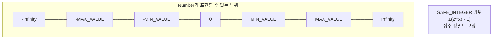
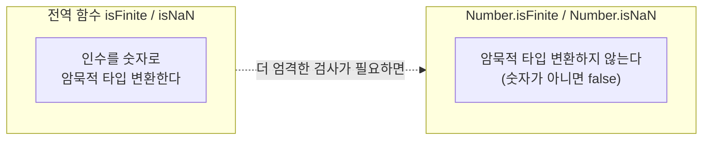

### Number 생성자 함수

- 표준 빌트인 객체인 **`Number`는 생성자 함수 객체**다. 따라서 `new` 연산자와 함께 호출하여 `Number` 인스턴스를 생성할 수 있다. ([21장](../../week08/윤홍비/21.빌트인_객체.md#표준-빌트인-객체))
- `Number` 생성자 함수에 **인수를 전달하지 않고 `new` 연산자와 함께 호출하면 `[[NumberData]]` 내부 슬롯에 `0`을 할당한 `Number` 래퍼 객체를 생성**한다.
  - ```javascript
    const numObj = new Number();
    console.log(numObj); // Number {[[PrimitiveValue]]: 0}
    ```
  - `[[PrimitiveValue]]`는 크롬 브라우저에서 `[[NumberData]]` 내부 슬롯을 표시하는 이름이다. (ES5에서는 `[[NumberData]]`를 `[[PrimitiveValue]]`라 불렀다)
- `Number` 생성자 함수의 **인수로 숫자를 전달하면서 `new` 연산자와 함께 호출하면 `[[NumberData]]` 내부 슬롯에 인수로 전달받은 숫자를 할당한 `Number` 래퍼 객체를 생성**한다.
  - ```javascript
    const numObj = new Number(10);
    console.log(numObj); // Number {10}
    ```
  - **래퍼 객체**는 원시값을 감싸는 객체로, 원시값에 대해 객체처럼 접근하면 생성되는 임시 객체다. ([21장](../../week08/윤홍비/21.빌트인_객체.md#원시값과-래퍼-객체))
- `Number` 생성자 함수의 **인수로 숫자가 아닌 값을 전달하면 인수를 숫자로 강제 변환**한다.
  - **숫자로 변환할 수 없다면 `NaN`을 `[[NumberData]]` 내부 슬롯에 할당한 `Number` 래퍼 객체를 생성**한다.
  - ```javascript
    let numObj = new Number("10");
    console.log(numObj); // Number {10}

    numObj = new Number("Hello");
    console.log(numObj); // Number {NaN}
    ```
- `new` 연산자를 사용하지 않고 `Number` 생성자 함수를 호출하면 **`Number` 인스턴스가 아닌 숫자를 반환**한다.
  - 이를 이용하여 **명시적으로 타입을 변환**하기도 한다. ([9장](../../week04/윤홍비/09.타입변환과_단축평가.md#명시적-타입-변환))
  - ```javascript
    // 문자열 타입 => 숫자 타입
    Number("0"); // 0
    Number("-1"); // -1
    Number("10.53"); // 10.53

    // 불리언 타입 => 숫자 타입
    Number(true); // 1
    Number(false); // 0
    ```

### Number 프로퍼티

#### Number.EPSILON

- **ES6에서 도입된 `Number.EPSILON`은 1과 1보다 큰 숫자 중에서 가장 작은 숫자와의 차이와 같다**.
  - 약 `2.2204460492503130808472633361816 * 10^-16`이다.
- `Number.EPSILON`은 **부동소수점으로 인해 발생하는 오차를 해결하기 위해 사용**한다.
  - 부동소수점 산술 연산은 **정확한 값을 표현하지 못하는 반올림 오차**가 있다.
  - 2진법으로 변환했을 때 **무한소수가 되어 미세한 오차가 발생**할 수밖에 없는 구조적 한계다.
  - ```javascript
    // 정수는 2진법으로 오차 없이 저장 가능하지만 실수는 그렇지 않다
    0.1 + 0.2; // 0.30000000000000004
    0.1 + 0.2 === 0.3; // false
    ```
- 따라서 **두 숫자의 차이가 `Number.EPSILON`보다 작으면 같은 수로 인식**하도록 비교한다.
  - ```javascript
    function isEqual(a, b) {
      // a와 b를 뺀 값의 절대값이 Number.EPSILON보다 작으면 같은 수로 인정한다
      return Math.abs(a - b) < Number.EPSILON;
    }

    isEqual(0.1 + 0.2, 0.3); // true
    ```

#### Number.MAX_SAFE_INTEGER / Number.MIN_SAFE_INTEGER

- **`Number.MAX_SAFE_INTEGER`는 자바스크립트에서 안전하게 표현할 수 있는 가장 큰 정수값**이다. (`9007199254740991`, 즉 `2^53 - 1`)
- **`Number.MIN_SAFE_INTEGER`는 자바스크립트에서 안전하게 표현할 수 있는 가장 작은 정수값**이다. (`-9007199254740991`)
  - ```javascript
    Number.MAX_SAFE_INTEGER; // 9007199254740991
    Number.MIN_SAFE_INTEGER; // -9007199254740991
    ```
  - 이 범위를 벗어나면 **정수의 정밀도가 보장되지 않는다**.
  - ```javascript
    Number.MAX_SAFE_INTEGER + 1 === Number.MAX_SAFE_INTEGER + 2; // true
    ```
  - 이 범위를 넘는 정수를 다뤄야 한다면 **`BigInt`를 사용**해야 한다.

#### Number.MAX_VALUE / Number.MIN_VALUE

- **`Number.MAX_VALUE`는 자바스크립트에서 표현할 수 있는 가장 큰 양수값**이다. (약 `1.7976931348623157 * 10^308`)
  - **`Number.MAX_VALUE`보다 큰 숫자는 `Infinity`** 다.
  - ```javascript
    Number.MAX_VALUE; // 1.7976931348623157e+308
    Infinity > Number.MAX_VALUE; // true
    ```
- **`Number.MIN_VALUE`는 자바스크립트에서 표현할 수 있는 가장 작은 양수값**이다. (약 `5 * 10^-324`)
  - **`Number.MIN_VALUE`보다 작은 숫자는 `0`** 이다.
  - ```javascript
    Number.MIN_VALUE; // 5e-324
    Number.MIN_VALUE > 0; // true
    ```
  - `MIN_VALUE`는 **가장 작은 음수가 아니라 0에 가장 가까운 양수**임에 주의한다.

#### Number.POSITIVE_INFINITY / Number.NEGATIVE_INFINITY

- **`Number.POSITIVE_INFINITY`는 양의 무한대를 나타내는 숫자값 `Infinity`와 같다**.
- **`Number.NEGATIVE_INFINITY`는 음의 무한대를 나타내는 숫자값 `-Infinity`와 같다**.
  - ```javascript
    Number.POSITIVE_INFINITY; // Infinity
    Number.NEGATIVE_INFINITY; // -Infinity
    ```

#### Number.NaN

- **`Number.NaN`은 숫자가 아님(Not a Number)을 나타내는 숫자값**이다.
  - `Number.NaN`은 `window.NaN`과 같다. ([21장](../../week08/윤홍비/21.빌트인_객체.md#빌트인-전역-프로퍼티))
  - ```javascript
    Number.NaN; // NaN
    ```
  - **`NaN`은 자신과 일치하지 않는 유일한 값**이다.
  - ```javascript
    NaN === NaN; // false
    ```



### Number 메서드

#### Number.isFinite

- **ES6에서 도입된 `Number.isFinite` 정적 메서드는 인수로 전달된 숫자값이 정상적인 유한수, 즉 `Infinity` 또는 `-Infinity`가 아닌지 검사하여 그 결과를 불리언 값으로 반환**한다.
  - ```javascript
    // true
    Number.isFinite(0);
    Number.isFinite(Number.MAX_VALUE);
    Number.isFinite(Number.MIN_VALUE);

    // false
    Number.isFinite(Infinity);
    Number.isFinite(-Infinity);
    ```
  - 인수가 `NaN`이면 언제나 `false`를 반환한다.
  - ```javascript
    Number.isFinite(NaN); // false
    ```
- `Number.isFinite` 메서드는 **빌트인 전역 함수 `isFinite`와 차이**가 있다.
  - **빌트인 전역 함수 `isFinite`는 전달받은 인수를 숫자로 암묵적 타입 변환하여 검사**를 수행한다. ([21장](../../week08/윤홍비/21.빌트인_객체.md#isfinite))
  - 하지만 **`Number.isFinite`는 전달받은 인수를 숫자로 암묵적 타입 변환하지 않는다**. 따라서 **숫자가 아닌 인수가 주어지면 언제나 `false`** 다.
  - ```javascript
    // Number.isFinite는 암묵적 타입 변환을 하지 않는다
    Number.isFinite(null); // false

    // isFinite는 암묵적 타입 변환을 한다. null은 0으로 변환된다
    isFinite(null); // true
    ```

#### Number.isInteger

- **ES6에서 도입된 `Number.isInteger` 정적 메서드는 인수로 전달된 숫자값이 정수인지 검사하여 그 결과를 불리언 값으로 반환**한다.
  - 검사하기 전에 **인수를 숫자로 암묵적 타입 변환하지 않는다**.
  - ```javascript
    // true
    Number.isInteger(0);
    Number.isInteger(123);
    Number.isInteger(-123);
    Number.isInteger(5.0); // 5.0은 정수다

    // false
    Number.isInteger(0.5);
    Number.isInteger("123"); // 문자열은 변환하지 않는다
    Number.isInteger(false);
    Number.isInteger(Infinity);
    Number.isInteger(-Infinity);
    ```

#### Number.isNaN

- **ES6에서 도입된 `Number.isNaN` 정적 메서드는 인수로 전달된 숫자값이 `NaN`인지 검사하여 그 결과를 불리언 값으로 반환**한다.
  - ```javascript
    Number.isNaN(NaN); // true
    ```
- `Number.isNaN` 메서드는 **빌트인 전역 함수 `isNaN`과 차이**가 있다.
  - **빌트인 전역 함수 `isNaN`은 전달받은 인수를 숫자로 암묵적 타입 변환하여 검사**를 수행한다. ([21장](../../week08/윤홍비/21.빌트인_객체.md#isnan))
  - 하지만 **`Number.isNaN`은 전달받은 인수를 숫자로 암묵적 타입 변환하지 않는다**. 따라서 **숫자가 아닌 인수가 주어지면 언제나 `false`** 다.
  - ```javascript
    // Number.isNaN은 암묵적 타입 변환을 하지 않는다
    Number.isNaN(undefined); // false

    // isNaN은 암묵적 타입 변환을 한다. undefined는 NaN으로 변환된다
    isNaN(undefined); // true
    ```



#### Number.isSafeInteger

- **ES6에서 도입된 `Number.isSafeInteger` 정적 메서드는 인수로 전달된 숫자값이 안전한 정수인지 검사하여 그 결과를 불리언 값으로 반환**한다.
  - 안전한 정수값은 **`-(2^53 - 1)`과 `2^53 - 1` 사이의 정수값**이다.
  - 검사하기 전에 **인수를 숫자로 암묵적 타입 변환하지 않는다**.
  - ```javascript
    // true
    Number.isSafeInteger(0);
    Number.isSafeInteger(1000000000000000);

    // false
    Number.isSafeInteger(10000000000000001); // 안전한 정수가 아니다
    Number.isSafeInteger(0.5);
    Number.isSafeInteger("123"); // 문자열은 변환하지 않는다
    Number.isSafeInteger(Infinity);
    ```

#### Number.prototype.toExponential

- **`toExponential` 메서드는 숫자를 지수 표기법으로 변환하여 문자열로 반환**한다.
  - **지수 표기법**이란 **매우 크거나 작은 숫자를 표기할 때 주로 사용**하며 `e`(Exponent) 앞에 있는 숫자에 10의 n승을 곱하는 형식으로 수를 나타내는 방식이다.
  - 인수로 **소수점 이하로 표현할 자릿수**를 전달할 수 있다.
  - ```javascript
    (77.1234).toExponential(); // '7.71234e+1'
    (77.1234).toExponential(4); // '7.7123e+1'
    (77.1234).toExponential(2); // '7.71e+1'
    ```
- **숫자 리터럴과 함께 메서드를 사용할 경우 에러가 발생**할 수 있으니 주의한다.
  - ```javascript
    77.toExponential(); // SyntaxError: Invalid or unexpected token
    ```
  - 자바스크립트 엔진은 숫자 뒤의 `.`을 **부동 소수점 숫자의 일부로 해석**하기 때문이다.
  - 따라서 **그룹 연산자를 사용하거나 공백을 추가**해야 한다.
  - ```javascript
    (77).toExponential(); // '7.7e+1'
    77 .toExponential(); // '7.7e+1' (공백 추가)
    77.0.toExponential(); // '7.7e+1'
    ```
  - 참고로 **정수 부분과 소수 부분을 구분하는 소수점 뒤의 `.`은 숫자로 해석**된다.

#### Number.prototype.toFixed

- **`toFixed` 메서드는 숫자를 반올림하여 문자열로 반환**한다.
  - 반올림하는 **소수점 이하 자릿수를 나타내는 0~100 사이의 정수값을 인수로 전달**할 수 있다. **기본값은 `0`** 이다.
  - ```javascript
    // 소수점 이하 반올림. 인수를 생략하면 기본값 0이 지정된다
    (12345.6789).toFixed(); // '12346'

    // 소수점 이하 1자리수 유효, 나머지 반올림
    (12345.6789).toFixed(1); // '12345.7'

    // 소수점 이하 2자리수 유효, 나머지 반올림
    (12345.6789).toFixed(2); // '12345.68'

    // 소수점 이하 3자리수 유효, 나머지 반올림
    (12345.6789).toFixed(3); // '12345.679'
    ```
  - **반환값은 숫자가 아닌 문자열**이므로 연산에 사용하려면 숫자로 변환해야 한다.
  - ```javascript
    typeof (1.5).toFixed(1); // 'string'
    Number((1.5).toFixed(1)); // 1.5
    ```

#### Number.prototype.toPrecision

- **`toPrecision` 메서드는 인수로 전달받은 전체 자릿수까지 유효하도록 나머지 자릿수를 반올림하여 문자열로 반환**한다.
  - 인수로 전달받은 전체 자릿수로 표현할 수 없는 경우 **지수 표기법으로 결과를 반환**한다.
  - 전체 자릿수를 나타내는 **0~100 사이의 정수값을 인수로 전달**할 수 있다. **기본값은 `0`** 이다.
  - ```javascript
    // 전체 자릿수 유효. 인수를 생략하면 기본값 0이 지정된다
    (12345.6789).toPrecision(); // '12345.6789'

    // 전체 1자리수 유효, 나머지 반올림
    (12345.6789).toPrecision(1); // '1e+4'

    // 전체 2자리수 유효, 나머지 반올림
    (12345.6789).toPrecision(2); // '1.2e+4'

    // 전체 6자리수 유효, 나머지 반올림
    (12345.6789).toPrecision(6); // '12345.7'
    ```
  - **`toFixed`는 소수점 이하 자릿수**를, **`toPrecision`은 전체 자릿수**를 기준으로 한다는 점이 다르다.

#### Number.prototype.toString

- **`toString` 메서드는 숫자를 문자열로 변환하여 반환**한다.
  - **진법을 나타내는 2~36 사이의 정수값을 인수로 전달**할 수 있다. **기본값은 `10`진법**이다.
  - ```javascript
    // 인수를 생략하면 10진수 문자열을 반환한다
    (10).toString(); // '10'

    // 2진수 문자열을 반환한다
    (16).toString(2); // '10000'

    // 8진수 문자열을 반환한다
    (16).toString(8); // '20'

    // 16진수 문자열을 반환한다
    (16).toString(16); // '10'
    ```

### 정리

| 프로퍼티 / 메서드          | 설명                                                                   |
| -------------------------- | ---------------------------------------------------------------------- |
| `Number.EPSILON`           | **부동소수점 오차 비교**에 사용하는 아주 작은 값                        |
| `Number.MAX_SAFE_INTEGER`  | **정밀도가 보장되는 최대 정수** (`2^53 - 1`)                            |
| `Number.MAX_VALUE`         | 표현 가능한 **가장 큰 양수** (초과 시 `Infinity`)                        |
| `Number.MIN_VALUE`         | 표현 가능한 **가장 작은 양수** (미만 시 `0`)                             |
| `Number.isFinite/isNaN`    | **암묵적 타입 변환 없이** 검사한다 (전역 함수와의 차이점)                |
| `toFixed`                  | **소수점 이하 자릿수** 기준 반올림. **문자열 반환**                      |
| `toPrecision`              | **전체 자릿수** 기준 반올림. **문자열 반환**                             |
| `toString(radix)`          | 숫자를 **지정 진법(2~36)의 문자열**로 변환                               |

- 자바스크립트의 숫자는 **배정밀도 64비트 부동소수점 형식 하나**만 사용한다. ([6장](../../week02/윤홍비/06.데이터타입.md))
  - 따라서 `0.1 + 0.2 !== 0.3`과 같은 **반올림 오차가 구조적으로 발생**하며, `Number.EPSILON`으로 비교해야 한다.
  - 정수 역시 **`±(2^53 - 1)` 범위 안에서만 정밀도가 보장**된다. 그 밖의 정수는 `BigInt`가 필요하다.
- **`Number.isFinite`, `Number.isNaN`은 전역 함수와 이름은 같지만 암묵적 타입 변환을 하지 않는다**.
  - 의도치 않은 타입 변환으로 인한 버그를 막기 위해 **전역 함수보다 `Number`의 정적 메서드를 사용하는 것이 안전**하다. ([21장](../../week08/윤홍비/21.빌트인_객체.md#빌트인-전역-함수))
- `toExponential`, `toFixed`, `toPrecision`, `toString`은 모두 **문자열을 반환하는 프로토타입 메서드**다.
  - 연산에 사용하려면 **다시 숫자로 변환**해야 한다.
  - 숫자 리터럴에 직접 사용할 때는 **그룹 연산자 `()`로 감싸야** 문법 에러를 피할 수 있다.
