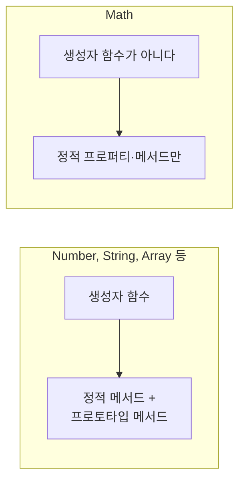
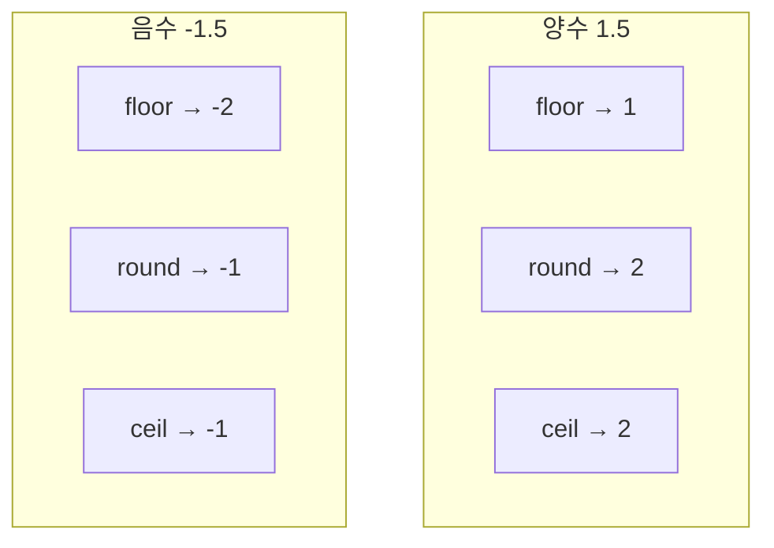

### Math란?

- 표준 빌트인 객체인 **`Math`는 수학적인 상수와 함수를 위한 프로퍼티와 메서드를 제공**한다. ([21장](../../week08/윤홍비/21.빌트인_객체.md#표준-빌트인-객체))
- **`Math`는 생성자 함수가 아니다**.
  - 따라서 **`Math`는 정적 프로퍼티와 정적 메서드만 제공**한다. ([19장](../../week07/윤홍비/19.프로토타입.md#정적-프로퍼티메서드))
  - 인스턴스를 생성할 수 없으므로 **`new` 연산자와 함께 호출하면 에러**가 발생한다.
  - ```javascript
    new Math(); // TypeError: Math is not a constructor
    ```
  - `Number`, `String` 등 다른 표준 빌트인 객체와 달리 **프로토타입 메서드가 없다**는 점이 특징이다.



### Math 프로퍼티

#### Math.PI

- **원주율 PI 값(`π`)을 반환**한다.
  - ```javascript
    Math.PI; // 3.141592653589793
    ```

### Math 메서드

#### Math.abs

- **`Math.abs` 메서드는 인수로 전달된 숫자의 절대값을 반환**한다.
  - 절대값은 **반드시 0 또는 양수**이어야 한다.
  - ```javascript
    Math.abs(-1); // 1
    Math.abs("-1"); // 1
    Math.abs(""); // 0
    Math.abs([]); // 0
    Math.abs(null); // 0
    Math.abs(undefined); // NaN
    Math.abs({}); // NaN
    Math.abs("string"); // NaN
    Math.abs(); // NaN
    ```
  - 인수를 **숫자로 암묵적 타입 변환**하므로, 변환할 수 없는 값은 `NaN`을 반환한다. ([9장](../../week04/윤홍비/09.타입변환과_단축평가.md#암묵적-타입-변환))

#### Math.round

- **`Math.round` 메서드는 인수로 전달된 숫자의 소수점 이하를 반올림한 정수를 반환**한다.
  - ```javascript
    Math.round(1.4); // 1
    Math.round(1.6); // 2
    Math.round(-1.4); // -1
    Math.round(-1.6); // -2
    Math.round(1); // 1
    Math.round(); // NaN
    ```
  - **소수점 이하가 정확히 `.5`인 경우 더 큰 정수 쪽으로 반올림**한다는 점에 주의한다.
  - ```javascript
    Math.round(0.5); // 1
    Math.round(-0.5); // -0 (-1이 아니다)
    ```

#### Math.ceil

- **`Math.ceil` 메서드는 인수로 전달된 숫자의 소수점 이하를 올림한 정수를 반환**한다.
  - 소수점 이하를 올림하면 **더 큰 정수가 된다**.
  - ```javascript
    Math.ceil(1.4); // 2
    Math.ceil(1.6); // 2
    Math.ceil(-1.4); // -1
    Math.ceil(-1.6); // -1
    Math.ceil(1); // 1
    Math.ceil(); // NaN
    ```
  - 음수의 경우 **0에 가까워진다**는 점에 주의한다. (`-1.6` → `-1`)

#### Math.floor

- **`Math.floor` 메서드는 인수로 전달된 숫자의 소수점 이하를 내림한 정수를 반환**한다.
  - 즉 `Math.ceil` 메서드의 **반대 개념**이다. 소수점 이하를 내림하면 **더 작은 정수가 된다**.
  - ```javascript
    Math.floor(1.9); // 1
    Math.floor(9.1); // 9
    Math.floor(-1.9); // -2
    Math.floor(-9.1); // -10
    Math.floor(1); // 1
    Math.floor(); // NaN
    ```



#### Math.sqrt

- **`Math.sqrt` 메서드는 인수로 전달된 숫자의 제곱근을 반환**한다.
  - ```javascript
    Math.sqrt(9); // 3
    Math.sqrt(-9); // NaN
    Math.sqrt(2); // 1.414213562373095
    Math.sqrt(1); // 1
    Math.sqrt(0); // 0
    Math.sqrt(); // NaN
    ```

#### Math.random

- **`Math.random` 메서드는 임의의 난수(랜덤 숫자)를 반환**한다.
  - 반환한 난수는 **0에서 1 미만의 실수**다. 즉 **0은 포함되지만 1은 포함되지 않는다**.
  - ```javascript
    Math.random(); // 0에서 1 미만의 랜덤 실수 (0.8208720231391746)
    ```
- 다음과 같이 **1에서 10 범위의 랜덤 정수**를 구할 수 있다.
  - ```javascript
    // 1 ~ 10 범위의 랜덤 정수
    const random = Math.floor(Math.random() * 10 + 1);
    console.log(random); // 1 ~ 10
    ```
  - `Math.random()`은 `0 <= x < 1`이므로 `* 10`을 하면 `0 <= x < 10`, `+ 1`을 하면 `1 <= x < 11`이 된다.
  - 여기에 `Math.floor`로 내림하면 **1 이상 10 이하의 정수**가 된다.

#### Math.pow

- **`Math.pow` 메서드는 첫 번째 인수를 밑(base)으로, 두 번째 인수를 지수(exponent)로 거듭 제곱한 결과를 반환**한다.
  - ```javascript
    Math.pow(2, 8); // 256
    Math.pow(2, -1); // 0.5
    Math.pow(2); // NaN
    ```
- `Math.pow` 메서드 대신 ES7에서 도입된 **지수 연산자** `**`를 사용하면 **가독성이 더 좋다**. ([7장](../../week03/윤홍비/07.연산자.md))
  - ```javascript
    // ES7 지수 연산자
    2 ** (2 ** 2); // 16

    Math.pow(Math.pow(2, 2), 2); // 16
    ```

#### Math.max

- **`Math.max` 메서드는 전달받은 인수 중에서 가장 큰 수를 반환**한다.
  - **인수가 전달되지 않으면 `-Infinity`를 반환**한다.
  - ```javascript
    Math.max(1); // 1
    Math.max(1, 2); // 2
    Math.max(1, 2, 3); // 3
    Math.max(); // -Infinity
    ```
- **배열 요소 중에서 최대값을 구하려면** `Function.prototype.apply` 메서드 또는 **스프레드 문법을 사용**해야 한다.
  - `Math.max` 메서드는 **배열을 인수로 전달받을 수 없기 때문**이다.
  - ```javascript
    // 배열을 그대로 전달하면 NaN
    Math.max([1, 2, 3]); // NaN

    // apply 메서드
    Math.max.apply(null, [1, 2, 3]); // 3

    // ES6 스프레드 문법
    Math.max(...[1, 2, 3]); // 3
    ```

#### Math.min

- **`Math.min` 메서드는 전달받은 인수 중에서 가장 작은 수를 반환**한다.
  - **인수가 전달되지 않으면 `Infinity`를 반환**한다.
  - ```javascript
    Math.min(1); // 1
    Math.min(1, 2); // 1
    Math.min(1, 2, 3); // 1
    Math.min(); // Infinity
    ```
- `Math.max`와 마찬가지로 **배열 요소 중에서 최소값을 구하려면 `apply` 메서드 또는 스프레드 문법을 사용**해야 한다.
  - ```javascript
    // apply 메서드
    Math.min.apply(null, [1, 2, 3]); // 1

    // ES6 스프레드 문법
    Math.min(...[1, 2, 3]); // 1
    ```
  - 인수 개수에는 **엔진별 한계**가 있으므로, 요소가 매우 많은 배열은 `reduce`로 처리하는 편이 안전하다. ([27장](./27.배열.md#arrayprototypereduce))

### 정리

| 메서드          | 설명                                                        |
| --------------- | ----------------------------------------------------------- |
| `Math.abs`      | **절대값**을 반환 (항상 0 또는 양수)                          |
| `Math.round`    | 소수점 이하 **반올림**. `.5`는 **더 큰 정수 쪽**으로           |
| `Math.ceil`     | 소수점 이하 **올림** (더 큰 정수)                             |
| `Math.floor`    | 소수점 이하 **내림** (더 작은 정수)                           |
| `Math.sqrt`     | **제곱근**을 반환 (음수는 `NaN`)                              |
| `Math.random`   | **`0 <= x < 1`** 범위의 랜덤 실수                             |
| `Math.pow`      | 거듭 제곱. **지수 연산자** `**` **로 대체 가능**                |
| `Math.max/min`  | 최대값/최소값. 인수가 없으면 **`-Infinity`/`Infinity`**        |

- **`Math`는 생성자 함수가 아니므로 인스턴스를 생성할 수 없고 정적 프로퍼티와 정적 메서드만 제공**한다.
  - 따라서 `Math.PI`, `Math.abs(...)`처럼 **언제나 `Math`를 통해 직접 호출**한다.
- **반올림 계열 메서드는 음수에서의 동작에 주의**해야 한다.
  - `ceil`과 `round`는 음수에서 **0에 가까워지는 방향**으로 동작한다. (`Math.ceil(-1.6)`은 `-1`, `Math.round(-0.5)`는 `-0`)
  - 소수점 자릿수를 다룰 때는 `Math.round` 대신 **`Number.prototype.toFixed`가 더 직관적**일 수 있다. ([28장](./28.Number.md#numberprototypetofixed))
- `Math.max`, `Math.min`은 **배열을 인수로 받지 못한다**.
  - **스프레드 문법으로 펼쳐서 전달**하는 것이 가장 간결하다.
- `Math.pow`는 **ES7 지수 연산자** `**` **로 대체**하는 것이 가독성 면에서 더 좋다.
